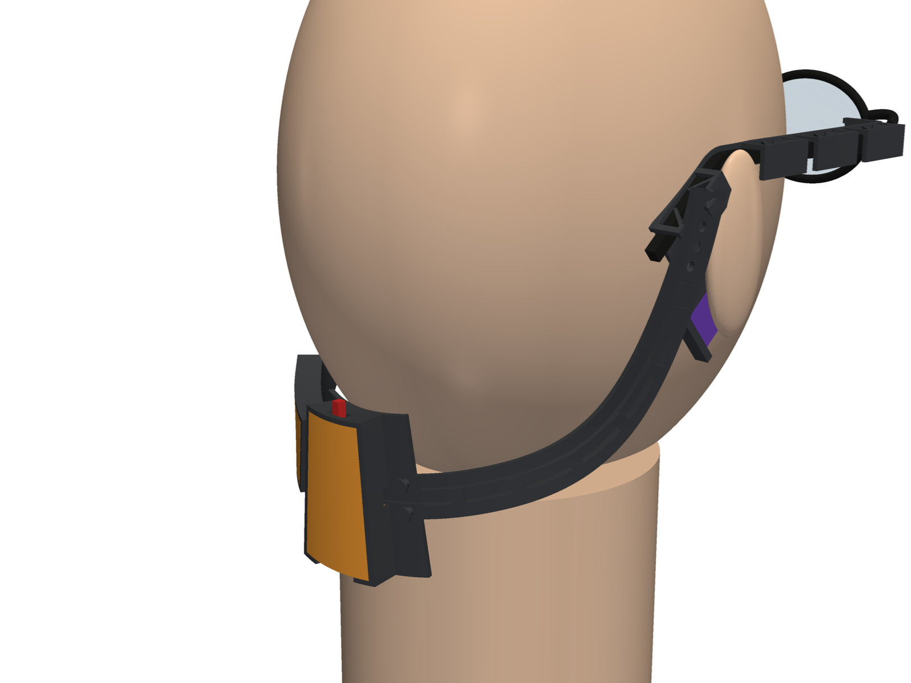
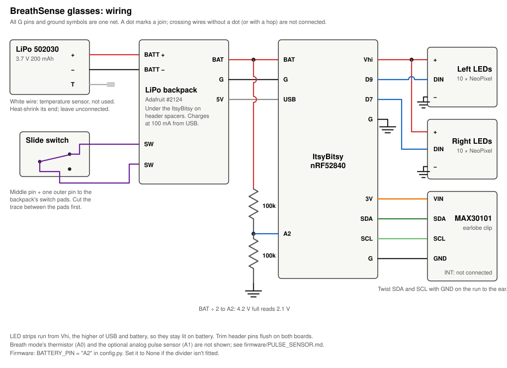

# Glasses mount

A parametric model, written in [build123d](https://github.com/gumyr/build123d),
for wearing BreathSense on an ordinary pair of glasses:

- **Temple sleeves** push down over each temple from above. Thin vertical
  leaves inside spring against the temple's outer face, so one sleeve fits
  temples 2–6 mm thick.
- **The LED strip** presses into an open channel on the head side of each
  sleeve. The channel bends round the glasses hinge, so the last two LEDs sit
  on the frame front, facing the eye.
- **A band that hangs behind the neck**, like a neckband headset, carries the
  electronics: the ItsyBitsy with an
  Adafruit LiPo backpack stacked on it, a power switch and the battery.
- **One sleeve** has an arm that holds the MAX30101 against the earlobe.

**Second sleeve design, not yet printed.** The first print showed that:
- the strip couldn't be threaded into its closed slot
- the flap's hinge web blocked the strip at the corner
- the sleeve didn't grip the temple
- the tip sock only fitted one size

This version replaces all four. Before printing whole sleeves, print the two
test pieces, about 1 g each, and try them on your glasses:
- `out/stl/test_sleeve_front.stl`: flap, corner and front clip
- `out/stl/test_sleeve_rear.stl`: last clip, neck, ear-end arch and band stud



`render_worn.py` places every part as worn on a simple head with glasses and
renders the views in `renders/`. It hangs the band behind the neck, and bends
the sleeves (printed straight) round the glasses hinge and down at the ear. Re-run it after changing the model (`pip install
build123d pyvista`). The head and glasses are rough adult-size stand-ins.

## Parts

| File | Material | What it is |
|---|---|---|
| `sleeve_right_ear` | TPU | Right temple sleeve with the earlobe sensor arm |
| `sleeve_left` | TPU | Left temple sleeve |
| `test_sleeve_front` | TPU | Front of the right sleeve (flap, corner, front clip), to test-print first |
| `test_sleeve_rear` | TPU | Back of the right sleeve (last clip, neck, ear-end arch), to test-print first |
| `band_left` | TPU | Band half with the battery socket |
| `band_right` | TPU | Plain band half. Its groove carries the right LED strip and sensor wires. |
| `band_center` | TPU | Center module with the ItsyBitsy socket (USB faces down, switch faces up) |
| `tray_itsybitsy` | PLA | Holds the ItsyBitsy with the backpack on it, and the slide switch |
| `tray_battery` | PLA | Holds the battery |

`out/step/` holds the parts as modelled. Open them in Fusion 360 with File →
Open, or upload them to a Fusion project. They come in as solid bodies you can
edit. `out/stl/` holds the same parts in print orientation, ready to slice.

## Building it in Fusion 360

`fusion/BreathSenseGlassesMount/` is a Fusion script that builds the same parts
as native Fusion components. Each part is ordinary sketches and extrudes in the
timeline, and the sizes are User Parameters.

1. **Add the script.** In Fusion, open Utilities → Add-Ins → Scripts and
   Add-Ins. Click **+** next to "My Scripts" and choose the
   `BreathSenseGlassesMount` folder.
2. **Run it.** It creates a new design, adds the parameters, and builds all 7
   parts as components named `BS …`.
3. **Resize.** Open Modify → Change Parameters, edit the values, then run the
   script again. It deletes the `BS …` components and rebuilds them from the
   new values in the same design.

Changing a parameter doesn't update the parts on its own; run the script again
to rebuild. Any hand edits to the `BS …` components are lost on a rebuild, so
settle the parameters first and make hand edits last.

The script's geometry has been checked against `glasses_mount.py` by running its
build steps through build123d (last checked after the sleeve redesign). All
parts match. The only difference is the stud heads (1.6 mm³ per sleeve), which
the script makes from small steps instead of a cone. The script has not been
run inside Fusion yet. If it fails, it shows the error in a message box.

The sleeves now need sketches on Fusion's YZ and XZ planes, not just XY. The
first time it uses each plane, the script extrudes a small test block and
checks where it lands, then deletes it. If Fusion orients a plane differently
from what the script expects, it stops with an error instead of building a
wrong part.

## Wiring



Power comes from a LiPo through an [Adafruit LiIon/LiPoly Backpack](https://www.adafruit.com/product/2124)
(product 2124). It charges the battery from the ItsyBitsy's USB port at 100 mA,
which suits a ~250 mAh cell. Leave the 500 mA jumper open. Two resistors let the
firmware read the battery voltage on A2.

```
 LiPo 3.7 V ──JST──┐
           ┌───────┴────────────┐
           │  LiPo backpack     ├── switch pads ── slide switch
           │  BAT    G    USB   │   (cut the trace between the pads first;
           └───┬─────┬─────┬────┘    wire the middle pin and one outer pin)
               │     │     │         soldered straight onto the ItsyBitsy's pins
 ItsyBitsy nRF52840
   BAT ──┬──────────── battery, after the switch
         │
        100k
         ├──────────── A2   (battery ÷ 2)
        100k
         │
   G  ───┘

   Vhi ─────────────── LED strips +  (both)
   G   ─────────────── LED strips −
   D9  ─────────────── left strip DIN
   D7  ─────────────── right strip DIN

   3V, G, SDA, SCL ─── MAX30101  (see firmware/PULSE_SENSOR.md)
```

- **Divider:** two 100k resistors in series from **BAT** to **G**, with their
  midpoint to **A2**. A full cell (4.2 V) reads 2.1 V, within the 3.3 V input.
  Battery voltage = `AnalogIn(board.A2).value / 65535 * 3.3 * 2`. Roughly
  4.2 V is full and 3.4 V is nearly empty. Tap BAT on the ItsyBitsy, after the
  switch, so the divider draws nothing when the device is off. Don't use A1:
  in `auto` mode the firmware reads A1 as the analog pulse sensor when no
  MAX3010x answers.
- **Firmware:** `firmware/battery.py` reads it every 2 s and sends
  `P,{mV},{percent},{usb}` to the app every 10 s and on connect. Percent is
  `-1` when no battery is seen (below 2.8 V: switch off or not fitted). The
  app shows the level next to the settings icon, with a charging icon while
  `usb` is 1. That flag comes from `supervisor.runtime.usb_connected`, so it's
  only set when the headset is plugged into a computer, not a wall charger.
  Voltage reads high while charging. If the divider isn't fitted, set
  `BATTERY_PIN = None` in `config.py`; a floating pin reads noise.
- **LED strips on Vhi.** Vhi carries the higher of USB and battery, so the
  strips stay lit on battery. The USB pin is dead without a cable.
- **Switch:** a panel-mount slide switch across the backpack's switch pads.
  Snip the two screw ears off its metal plate with flush cutters. That leaves
  a plate 10.5 × 5.5 mm, 8 mm deep including the pins, which fits inside the
  tray's end wall, with the lever through the slot. It disconnects the battery from BAT. With USB plugged
  in, the ItsyBitsy runs from USB whatever the switch is set to. Adafruit don't
  say whether the battery still charges with the switch off, so test it: switch
  off, plug in USB, and watch the backpack's charge LED.
- **Backpack underneath:** mount the backpack on the underside of the
  ItsyBitsy, at the USB end, on the header spacers. That keeps the reset and
  user buttons usable. Mounted on top, it covers them; then short **RST** to
  **G** twice quickly to get into the bootloader.
- **Header pins:** trim them flush on both boards. They stick out about 2 mm
  below the backpack, and the tray allows for a 9.5 mm stack.
- **Battery leads:** the 502030 cell has three wires. Red is **+** and black
  is **−**. White is usually a temperature sensor, which the backpack doesn't
  use, so cover its end with heat-shrink and leave it unconnected. Check this
  with the seller if you can. Either crimp or solder a 2-pin JST-PH plug onto
  red and black, which keeps the battery removable, or solder
  them straight to the backpack. Get the polarity right: red to **+** as marked
  on the backpack. Cut and strip one lead at a time so the bare ends can't
  touch. Put the cell in its tray with the leads at the end nearest the center
  module. The tray leaves `BATTERY_LEAD` (4 mm) there for them to bend. They
  leave through the opening in that end wall, then run along the band groove
  to the backpack.
- **Wire size:** use thin silicone wire, 28–30 AWG (about 0.7–1 mm across
  the insulation), for the runs along the band. The routes below are sized
  for wires up to 1 mm.

| Route | Wires | Space |
|---|---|---|
| Sleeve, each side | 3 (LED strip) | the LED channel itself, 4.4 × 1.4 mm, from the strip's back end to the neck, and again along the ear-end arch to its open end |
| Across the neck | 3 | none: they cross the 20 mm gap loose. Tie them to the neck with thread if they snag |
| Right band | 7 (right LEDs: Vhi, G, D7; sensor: 3V, G, SDA, SCL) | 4 × 3 mm channel between the rails, 3 rows deep |
| Left band, under the battery | 3 (left LEDs) | 4 × 1 mm groove, one layer |
| Left band, battery to the center | 5 (left LEDs + battery) | groove, open above |
| Into the ItsyBitsy tray | 7 from the right, 5 from the left | 6 × 3 mm opening in each side of the socket and tray |
| Ear arm | 4 (sensor) | no groove: twist them and tie or tape them along the arm |

## Regenerating the STEP and STL files

```
pip install build123d
python glasses_mount.py
```

Set `EAR_SIDE = "left"` to put the sensor arm on the left sleeve.

## Fitting

1. **Strip first.** Press the strip into the open channel on the sleeve's head
   side, LEDs facing out, before the sleeve goes on the glasses. It pushes in
   past short lips, one pair every two LEDs, and can still slide along to
   adjust. Put the 8th LED about 1 mm behind the start of the slotted corner
   (`LED_X` in the model), so the 8th and 9th LEDs fall either side of the
   bend. The channel runs on past the strip's back end. The strip's three
   wires lie in it, under the same lips, back to the neck.
2. **Clips.** Hold the sleeve with its inner leg (the LED side) against the
   inside of the temple, and push the clips straight down over the temple. The
   bottom edges of the leaves slope, so the temple turns them aside as it goes
   in. Seat the top bars on the temple's top edge. Start at the front clip.
   If a leaf folds the wrong way, ease it with a fingernail.
3. **Corner and flap.** Bend the channel inward round the glasses hinge, so
   the flap's two LEDs face the eye from the back of the frame front. The
   slots in the corner close up as it bends, and the floor there is thinner
   so it bends easily. It has to curve round your hinge screw head, which
   stands 3.2 mm out of the temple. The model doesn't know where along the
   temple the screw sits: the front clip starts 6 mm behind the hinge
   (`CLIP_FRONT`) on a guess. Nothing holds the flap but its own spring against
   the frame. If it won't stay, a small piece of double-sided foam tape will
   hold it.
4. **Ear end.** The low neck bends down with the temple at the ear. The bend
   can fall anywhere from 86 to 106 mm behind the hinge, but the whole 25 mm
   arch only sits on the tip if the bend is at least (131 − tip length) mm
   behind the hinge: 92 mm for your 39 mm tips. Push the ear-end arch down
   over the temple tip the same way as the clips. Its end is open, so a
   longer tip just runs out past it.
5. **Wires.** At the neck, the three wires leave the channel and cross loose to
   the ear-end arch, where they press into its channel and run out of its open
   end. Measure your wires: the channel takes three side by side up to `WIRE_D`
   (1 mm).
6. **Band.** Each band half's outer end presses over the stud on the outside of
   its ear-end arch. The inner ends press over the center module's studs. The band
   hangs down behind the ears and rests across the back of the neck, like a
   neckband headset. It's meant to be loose, so the glasses go on and off
   without adjusting anything.
   - The row of holes sets how low it hangs. Choose a hole where the center
     module rests on the back of the neck. Then cut off the tail about 5 mm
     past the hole, so it doesn't stick up past the stud.
   - Wires run in the channel along the band's outer face, threaded under the
     short bridges. They pass under the battery socket in its groove, and into
     the trays through the openings in the socket and tray walls.
7. **Trays.** Put the ItsyBitsy (with its backpack) in its tray with the USB at
   the port cut-out, and the switch at the other end with its actuator through
   the slot. Snap the trays in with their open side against the band. Line up
   the port cut-out and switch slot with the gaps in the socket wall. The USB
   port then faces down and the switch faces up, both clear of the band.
8. **Ear arm.** Slide the sensor board into the pod from the bottom edge,
   sensor side outward, toward the earlobe, and push it past the two small
   bumps at the opening, which keep it from dropping out. The sensor wires leave through the
   slot in the pod's front end and run up the arm. Twist them and tie or tape
   them along it. Bend the arm so the sensor faces the inner side of the
   earlobe. Glue an insulated magnet to the board's back and use a second
   magnet on the outside of the lobe. If the bumps don't hold it, a dab of
   glue at the pod's bottom edge will.

## Printing

- **Sleeves** print straight, standing on their top face. That face is the
  clips' top bars and the top edge of the inner leg, and it's flat. Everything
  else stands up from it: the inner leg, outer legs and leaves are vertical
  walls, and the leaves' sloped bottom edges are on top. Overhangs:
  - The LED channel's lower wall and the lips overhang 1.4 mm along the
    channel.
  - The stud prints on its side with a flat top. Only its head's cone
    overhangs.
  - On the ear sleeve, the arm and sensor pod stand 50 mm tall. The gusset
    under the pod widens at 45°. The pod's openings run out through its top
    as printed, so nothing bridges. That's tall for TPU, so use a brim and
    print slowly. If it wobbles, the arm can be split off into a separate
    clip-on part.

  None of it needs supports.
- **Band parts** print flat with the sockets facing up.
- **Trays** print floor-down in PLA.
- **Bed size.** The longest parts are the band halves at 169 mm.
- **Center module** is about 52 mm tall, because the switch sits above the
  ItsyBitsy.

## What has been checked, and what hasn't

Checked in the model:
- Each part is one solid.
- **Sleeve fit range** (`renders/sleeve_fit_range.png`): the unloaded leaves
  reach to 1.5 mm from the temple's inner face, and fold flat enough for a
  6 mm temple with 0.3 mm to spare. Treating each leaf as rigid about its root,
  they turn 5° on a 2 mm temple, 22° on your 4 mm one and 37° on a 6 mm one,
  and the two leaves in a clip don't meet. That's an estimate. A real leaf
  bends along its length.
- **Lead-in:** pushing the clip down, the temple's top edge meets the sloped
  bottom edge of each leaf, never its end. The push turns the leaf outward as
  long as the friction coefficient between TPU and the temple stays below
  about 1.2 (normal force against friction, worked out on the leaf
  geometry). The leaves stand vertical, so the push along them doesn't bend
  them.
- Insert checks, each a test body that must not touch the part:
  - the strip PCB slides behind the lips from the flap's tip to the last LED
  - the LED window between the lips is open along the whole channel
  - three 1 mm wires fit in the channel from the strip back to the neck, and
    along the ear-end arch to its open end
  - the corner slots cut through both channel walls
  - the top bar is clear between each clip's end bridges, so the leaves stand
    free
  - the sensor board and its components fit the pod, and slide in from its
    bottom edge with only the two detents in the way
  - each wire route in the bands, sockets and trays (see Wiring) is clear for
    its wires
- Lips are present at all 8 pairs of positions on each sleeve.
- No LED falls in the corner bend: the nearest LED centre is 1 mm from either
  end, and the LEDs are 2 mm wide.
- Print overhangs, from the print-oriented STLs: only those listed under
  Printing.
- Each tray clears its component by 0.3 mm per side.
- The switch body fits its bay at the end of the ItsyBitsy tray. The actuator
  slot runs clear through the tray wall and the socket wall.
- Band length is 280–352 mm from sleeve stud to sleeve stud, across the
  adjustment holes. In `render_worn.py`, the middle hole hangs the center
  module about 100 mm below the temples, on an adult-size stand-in head.

Not checked:
- **Grip.** Nothing has been printed since the redesign. In soft TPU the
  leaves push only lightly (roughly 0.03–0.3 N each, by beam estimate). A lot of the
  hold will come from TPU friction, the top bars seating on the temple, and
  the band pulling down. Thin metal temples will grip least. If the leaves
  are too weak, raise `LEAF_T` to 1.2 mm.
- **Top edge.** Your temple drops from 8.1 to 4 mm tall toward the ear. If its
  top edge curves down, the straight inner leg can't follow it, and the rear
  clips won't seat. Check this with the test piece's clip at the back of the
  temple.
- **Neck range.** The ear bend has to fall within the neck: 86–106 mm behind
  the hinge.
- **Ear-end arch under load.** The band hangs from a stud on the arch's outer
  leg, about 9 mm out from the temple's inner face. That pull tries to peel
  the open-bottom arch off the tip, which the old closed sock couldn't do.
  The arch is also sized for a 6 mm temple, so on your 3.5 mm tip its outer
  leg sits well outboard. Check both with the rear test piece and a band
  half hanging from it.
- **Corner.** Whether the flap's spring holds it against the frame front, and
  whether the corner clears your hinge screw.
- Fit on real glasses or a real head.
- How the hanging band pulls on the glasses. The band, center module, trays
  and electronics weigh about 35–40 g at 100% infill. The temple tips carry
  whatever part of that the neck doesn't. If the glasses tip forward, print
  the band halves lighter or with less infill.
- Part sizes are measured, but no tray has been test-fitted. Print the
  ItsyBitsy tray first and check the board and switch drop in.
- USB plug clearance with real plugs.

Measure these and adjust:

| Setting | What it is |
|---|---|
| `T_W_MIN`, `T_W_MAX` | Thinnest and thickest temple the leaves grip |
| `LEAF_T`, `LEAF_ANGLE` | Leaf thickness (grip force) and angle |
| `CLIP_FRONT`, `CORNER_X1` | Where the corner bends, relative to the glasses hinge |
| `NECK_L` | Neck length: the range of ear-bend positions it takes |
| `STRIP_W`, `LED_PITCH` | LED strip width and spacing; check the LEDs line up with the window |
| `WIRE_D`, `WIRE_N` | LED strip wire diameter and count, for the channel |
| `REF_*`, `TEMPLE_STRAIGHT`, `TIP_ANGLE` | Your glasses, for the renders only; they don't change the sleeve |
| `ITSYBITSY`, `BATTERY` | Board stack (ItsyBitsy + backpack) and battery sizes |
| `BATTERY_LEAD` | Room in the battery tray for the leads to bend |
| `SWITCH`, `SWITCH_SLOT` | Slide switch body and the actuator slot it needs |
| `BOARD_L`, `BOARD_H`, `POD_DEPTH` | Pimoroni MAX30101 breakout, and how far below the temple it sits |
| `BAND_HALF_LEN` | Band length; it should hang loose behind the neck |
