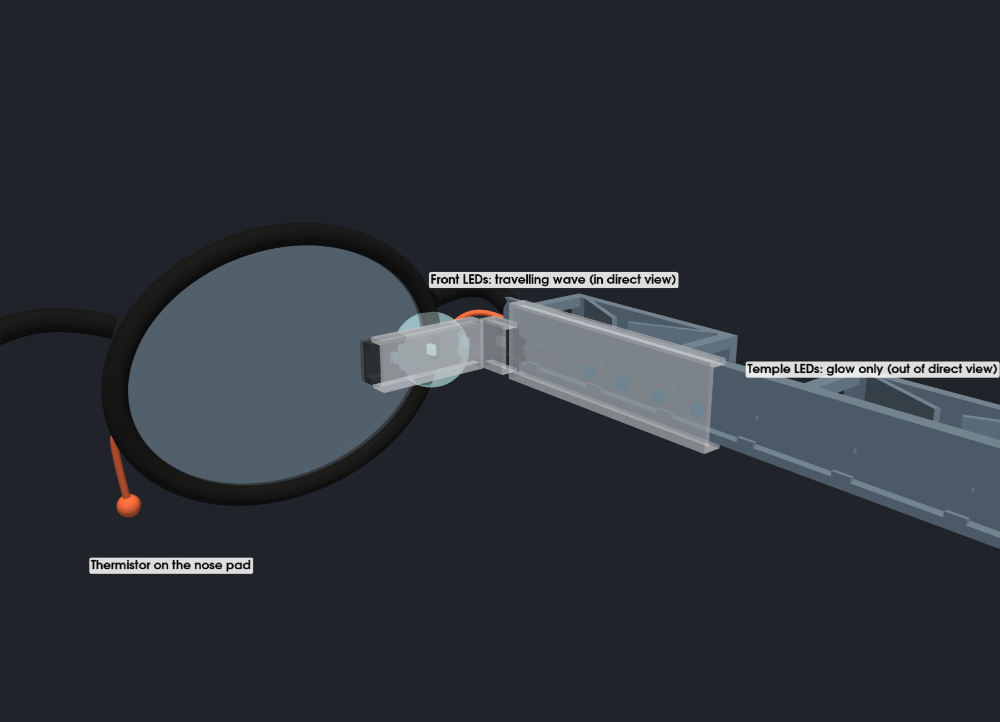
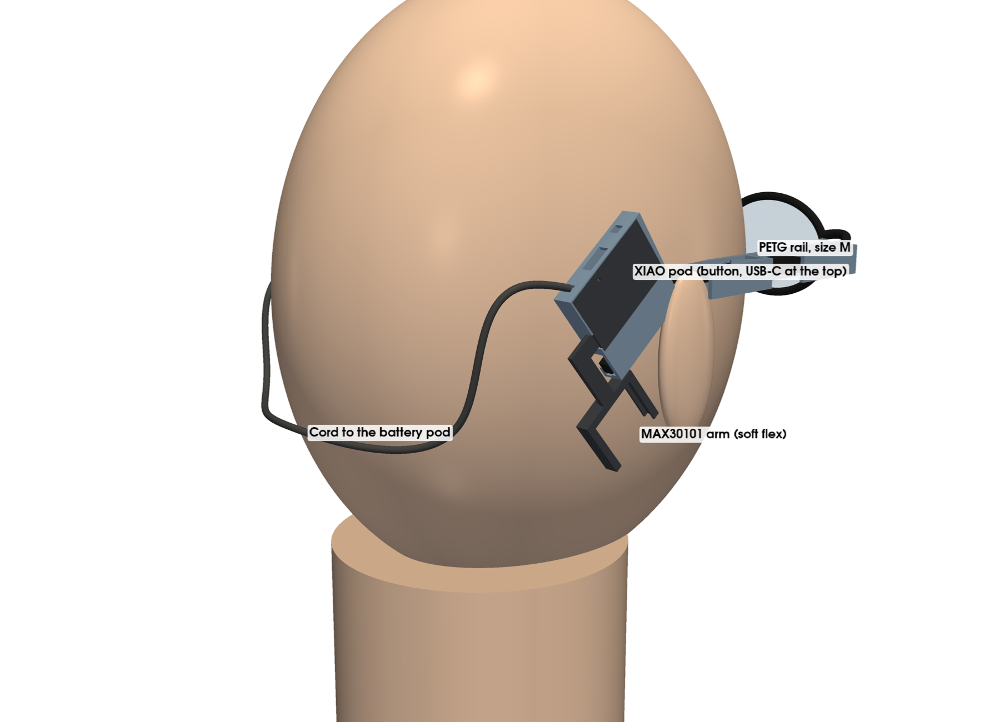

# BreathSense v2 hardware (proposal)

A second hardware configuration for the glasses, worked out from the first
prototype (ItsyBitsy nRF52840, LiPo backpack, neck band). It reuses parts
already on hand: a Seeed XIAO nRF52840 Plus, the 10-LED NeoPixel strips, the
MAX30101 and the 250 mAh cell. New parts cost about $10. Nothing here is built
yet.

## What the wearer sees

The display sits in peripheral vision, which sees motion and brightness
changes well but detail and colour poorly. So every cue is motion. Colour is
only a slow background hint.

Both sides show the same thing. The phone app or the button picks the mode:
breath, heart or guided.

| Signal | Shown as |
|---|---|
| Breath phase | A wave travels forward along the front LEDs on the in-breath and back on the out-breath |
| Breath depth | How far the wave travels and how long the lit segment is |
| Breath length | How fast the wave travels |
| Breath regularity | Steady breathing gives a smooth wave; irregular breathing gives a shimmer of small random brightness changes |
| Heartbeat | A short swell runs from the front back into the temple glow |
| HRV | How much the spacing and strength of the swells vary |

The firmware cross-fades the wave crest between neighbouring LEDs, so behind
the diffuser it reads as smooth motion rather than steps.

### Where the light can be seen

These angles are estimated from typical frame geometry. The LED sweep test
(below) measures them on real glasses.

- **Hinge and front flap (about 75–95° from straight ahead):** in direct view.
  Position and direction can be told apart, so the travelling cues go here.
  With 6.8 mm spacing, 5 LEDs per side fall in this zone: 3 on the corner's
  flap, 1 at the hinge and the front LED on the rail.
- **Temple, 15–30 mm behind the hinge (about 95–110°):** at the edge of the
  field. Only bright changes are noticed.
- **Rest of the temple:** out of direct view. Its light reaches the eye only as
  glow off the back of the lens, the frame and the skin. It works as a
  brightness channel (swell, pulse), but not as position.

## Parts

| Part | Notes | Cost |
|---|---|---|
| Seeed XIAO nRF52840 **Plus** (on hand) | Same chip as the ItsyBitsy, but 21×17.5 mm. Built-in LiPo charger (no backpack), extra pads. No IMU or microphone | $0 |
| Adafruit Ultra Skinny NeoPixel 1515 strip, 4 mm, 150 LEDs/m (on hand, as 10-LED pieces) | SK6805-EC15 LEDs. One 10-LED piece per side: 3 on the corner's flap against the frame front, 1 at the hinge, 6 along the temple | $0 |
| MAX30101 earlobe sensor, 502030 250 mAh LiPo (on hand) | | $0 |
| Fast 10k bead NTC thermistor | Breath sensor on a nose pad, in the breath stream | ~$2 |
| P-MOSFET (e.g. AO3401) and 100k gate pull-up | Cuts all LED power when the display is off or the battery is low | ~$0.50 |
| 6×6 mm or smaller tactile button | Wake, sleep and mode | ~$0.50 |
| Natural (translucent) PETG | For the printed diffuser covers (see Mount); neon-flex is too big for the open channel. A small spool if you don't have one | $0–15 |
| PETG, plus the soft flex filament (on hand) | Rigid rails and clips, with soft-flex liners and corners (see Mount) | $0 |
| **Total** | | **about $8, or $23 with natural PETG** |

About $40 of the budget is left. If 5 visible LEDs per side look too coarse,
the best use is a custom flex PCB with about 12–14 tiny LEDs for the front
section only.

Strip sources:
- [Adafruit 4368](https://adafruit.com/product/4368)
- [SK6805-EC15 (LCSC)](https://www.lcsc.com/product-detail/C2890035.html): 1 kHz PWM, 3.7–5.5 V

## Layout

- **Behind the right ear:** a pod with the XIAO Plus, the button and a reset
  pinhole. The MAX30101 earlobe arm reaches from it to the back of the
  earlobe.
- **Behind the left ear:** a pod with the battery.
- **Behind the head:** a thin cord with four wires joins the pods: battery +,
  ground, the switched LED supply and the left strip's data. There is no neck
  band.
- **LEDs:** a 10-LED piece on each side: 6 in the rail's channel, 4 in the
  corner piece (1 at the hinge, 3 on the flap). Nothing touches the lens rim, so it fits any frames. Each strip
  has its own data pin, as in v1.
- **Thermistor:** on the right nose pad. Its two wires run along the frame
  front to the right hinge, then along the right rail's channel to the board
  pod.

## Power and switching

There is no power switch.

- **LED power** comes from the battery through the P-MOSFET. The MOSFET is off
  whenever the LEDs are dark, because each NeoPixel draws about 1 mA even when
  showing black.
- **LED low-voltage cut-off at 3.6 V.** The SK6805 is rated for 3.7–5.5 V.
  Below that, blue dims and the LEDs can misread data. When the battery reads
  under 3.6 V, the firmware:
  1. switches the LEDs off;
  2. sends a low-battery notice to the app;
  3. goes into deep sleep until USB is plugged in.

  This gives up roughly the last 20% of the cell. A 5 V boost converter for
  the LEDs would recover it, if needed later.
- **Auto sleep.** With no breath and no pulse for about 2 minutes (glasses off),
  the board switches off the LEDs and the MAX30101 and goes into nRF52 System
  OFF, drawing a few µA.
- **Wake.** Press the button. Plugging in USB also wakes it. After waking it
  shows a short start-up sweep. If it sees no breath or pulse within 30 s, it
  goes back to sleep, so a knock in a bag doesn't leave it running.
- **Button while awake.** A short press changes mode. A long press puts it to
  sleep.
- **Watchdog timer.** The nRF52 hardware watchdog resets the board if the
  firmware hangs. After the reset it goes back to sleep, so a hang can't drain
  the battery.
- **Reset pinhole** over the XIAO's reset button, for when everything else
  fails.
- **Charging:** plug USB-C into the right pod. The battery charges through
  the cord.

### What the LEDs show for each state

Every power change shows on the LEDs, so the wearer always knows the state.
These use the same motion language as the main display.

| Event | LEDs |
|---|---|
| Wake (button, USB) | One soft white sweep from the front to the back, about 0.8 s |
| Auto sleep coming | Three slow, dim swells over about 5 s. Pressing the button or breathing on the sensor cancels it |
| Going to sleep (auto or long press) | A sweep from the back to the front that fades out, about 1 s; then dark |
| Mode change | The new mode's pattern plays once (1, 2 or 3 short pulses), then the display starts |
| BLE connected / disconnected | The existing connect animation / one dim blip |
| Low battery warning (about 3.75 V) | One amber blip every 30 s, on top of the display |
| Low battery cut-off (3.6 V) | Three amber flashes, then the sleep sweep in amber |
| Charging, plugged in while asleep | A slow amber swell every few seconds; steady dim green when full. Runs on USB power, so it costs the battery nothing |
| Recovered from a hang (watchdog reset) | One short red blip, then back to sleep |

The low-battery signals use amber and red because blue fails first as the
voltage drops. Red and green still work at 3.6 V.

### Estimates

| Load | Awake | Asleep |
|---|---|---|
| XIAO with BLE | ~5 mA | ~3 µA |
| MAX30101 | ~3 mA | ~1 µA |
| 20 NeoPixels at indoor brightness, including their idle draw | ~30–45 mA | 0 (MOSFET off) |

Runtime is about 3–3.5 h on 250 mAh, down to the 3.6 V cut-off. Standby is
months.

## Mount

`mount_v2.py` models the mount; `render_v2.py` draws it on the stand-in head
(`renders/`).

The first print, in soft flex filament, was too flimsy everywhere: the clips
didn't grip, and the neck, the hinge corner and the straight sections all
flopped. The v2 mount moves the structure into PETG and uses the soft flex
only where it helps (grip and the corner).

### Parts

| File (`out/stl/`) | Material | What it is |
|---|---|---|
| `test_clip_S`, `_M`, `_L` | PETG | One clip on a short length of rail. Print these first and try them on your glasses |
| `rail_right_S/M/L`, `rail_left_S/M/L` | PETG | The full rail for each temple, in three sizes |
| `liner` | Soft flex | Grip liner. Print 4 (two per rail) |
| `corner_right`, `corner_left` | Soft flex | Carry the front four LEDs round the hinge and along the frame front |
| `diffuser` | Natural (translucent) PETG | Snap-on cover over each rail's LED channel. Print 2; it fits either side |
| `corner_cap_hinge`, `corner_cap_flap` | Natural (translucent) PETG | Covers over the corner's LEDs. Print 2 of each |
| `pod_board_S/M/L` | PETG | Right pod: XIAO, button, MAX30101 arm root. Sized by the temple tip |
| `pod_battery_S/M/L` | PETG | Left pod: battery and the cord junction |
| `lid_board`, `lid_battery` | Soft flex | Press-in lids on the pods' outer faces |
| `pod_liner` | Soft flex | Grip liner under each pod's tip bar. Print 2 |
| `max_arm` | Soft flex | MAX30101 arm and cradle |

`out/step/` holds the same parts as fitted, in worn coordinates.

### Rail

- **Shape:** a PETG bar on the temple's inner face, from 6 mm behind the hinge
  to just before the ear bend. Its open LED channel is on the head side, with
  snap lips, as in v1. The wires carry on along the same channel to the rail's
  back end, then cross the ear bend loose to the pods.
- **Clips:** two clips, each 32 mm long, push down over the temple from above.
  Each has a top bar, an outer leg and two thin PETG leaves angled toward the
  temple. Pushing down, the leaves' sloped bottom edges ride over the temple's
  top edge and swing aside.
- **Grip:** the leaves press the temple against a soft-flex liner. The liner
  slides into a dovetail groove along the rail's temple face from the back end:
  push the front clip's liner all the way forward first, then fit the rear one.
- **Any temple height:** the leaves span the full 9 mm clip height, so they
  grip temples of any height from about 3 mm up.

### Sizes

PETG is far stiffer than the soft flex, so one rail can't safely grip 2–6 mm
temples. Each size covers about 1.3 mm of temple thickness:

| Size | Temple thickness | Grip per leaf | Peak leaf stress |
|---|---|---|---|
| S | 2.0–3.3 mm | 0.4–2.2 N | 5–25 MPa |
| M | 3.3–4.6 mm | 0.4–2.2 N | 5–25 MPa |
| L | 4.6–6.0 mm | 0.4–2.3 N | 5–27 MPa |

The reference glasses (4.0 mm at the front clip, about 3.5 mm at the rear)
take **M**.

The grip figures are 10–70 times the v1 sleeve's. The stresses stay under about
30 MPa (PETG yields at about 50). These come from simple beam formulas, not a
test. PETG also creeps a little under constant load, so the grip may ease off
over weeks. If it does, step down a size.

If a temple tapers past a size boundary between the clips, use the size that
fits the front clip.

### Corner

The corner is soft flex, but printed already bent at 100°, 10° past the
frame's 90°. The old corner was printed straight and kept trying to
straighten, which is why the flap flopped. This one holds its flap against the
frame front at rest, and bends further when the glasses fold.

It slides down onto a tongue on the rail's front end and grips it by a slight
interference fit. It carries the front four LEDs:
- **Hinge:** the 7th LED, on the corner's straight part just before the
  bend.
- **Flap:** the 8th, 9th and 10th LEDs, 1.5, 8.3 and 15.1 mm along it. Two
  snap lips between them hold the strip in.

The flap is 20 mm long, so on most frames it reaches in behind the outer edge
of the lens.

### Diffuser

A thin PETG plate stands 1.5 mm off the channel mouth, so the LEDs blur into a
line, with hooks over the rail's top and bottom edges. Fit it after the strip
is in: hook the bottom edge on, then press the top hook over. Print it in
natural PETG. If the LEDs still show as dots, a thicker plate or a bigger gap
(`DIFF_T`, `DIFF_GAP`) blurs them more.

**Corner caps.** The corner LEDs are the ones in direct view, the ones that
carry the travelling wave, so they get covers too:
- **Hinge cap:** a short cap on the corner's straight part, over the hinge
  LED.
- **Flap cap:** a long cap along the flap, over its three LEDs.

The bend between them is left open, so the corner can still bend when the
glasses fold. Both caps hook over the corner's top and bottom edges like the
rail diffuser. Both fit either side: turn them over for the left.
On soft flex, the hooks hold less firmly than on the rigid rail; if a cap
won't stay, a dot of flexible glue fixes it.

### Pods

- **On the tip:** each pod clips onto the temple tip behind the ear. It slides
  on from the tip's end and sits flat on the bone behind the ear. Only a thin
  bar runs under the tip, on the ear side.
- **Grip:** two PETG leaves inside press the tip down onto that bar, which
  carries a soft-flex liner like the rail's. The liner slides in from the
  tip-end face. The leaves lie in the pod's own plane, so they add no
  thickness. They lean toward the tip's
  end, so sliding the pod on bends them aside, and pulling it off doesn't
  catch.
- **Sizes:** sized by the tip. The reference tip (3.5 × 4.5 mm) takes **M**.

  | Size | Tip thickness | Tip height |
  |---|---|---|
  | S | 2.5–3.3 mm | 3.0–4.3 mm |
  | M | 3.3–4.2 mm | 4.3–5.6 mm |
  | L | 4.2–5.2 mm | 5.6–7.0 mm |

  The pod leaves are shallower (4 mm) than the rail's, so each presses with
  only about 0.15–0.85 N. That is over 10 times a pod's weight, but the tip
  slopes down toward its open end, there's no end stop, and the cord tugs on
  the pods when you turn your head. Pod grip is the weakest in the build:
  test it first.
- **Will it fit your tip?** The pod's slot is a straight, rigid 36 mm run,
  nearly the tip's whole length. Hold a straightedge along your tips: a tip
  that curves along its length, or ends in a ball, won't slide in. A shorter
  pod would fit a curved tip; tell me if you need one.
- **Board pod (right):**
  - **XIAO:** sits under a soft-flex lid on the outer face, with its USB-C
    pointing out of the pod's far end (up and back when worn). Check where
    your board's reset button is: the lid's 1.2 mm reset pinhole assumes it is
    5 mm to one side of the USB-C.
  - **Button:** a 6×6 mm tactile button in the front column. Its plunger
    comes out beside the USB-C.
  - **Wires:** the rail's wires enter at the front. The cord leaves from the
    far end.
- **MAX30101 arm:**
  - **Fitting:** a soft-flex flange is trapped inside the board pod under the
    lid.
  - **Path:** the strap leaves the tip-end face, runs past the end of the
    tip, then crosses toward the ear.
  - **Cradle:** at the strap's end, it holds the breakout with its sensor
    window outward, against the back of the earlobe. The board slides into the
    cradle from its far end.
  - **Fit:** it is printed flat as an L, and bends to suit the ear.
- **Battery pod (left):** holds the 502030 cell under its lid. The cord comes
  in at the tip end, and the left strip's wires at the front.

### Printing

- **Rails and test clips:** PETG, top face down on the bed, no supports. The
  leaves and outer legs stand up from the bed. Use at least 2 perimeters (the
  leaves are 0.8 mm thick, two lines with a 0.4 mm nozzle). The only overhangs
  are the 45° lead-in ramps and the 1.4 mm channel and lip ledges.
- **Pods:** PETG, head-side face down, no supports. The leaves stand up from
  the bed, and the cavity opens upward. The outer wall bridges 9–11 mm over
  the tip slot.
- **Diffuser and corner caps:** natural PETG, plate down.
- **Liners, lids and arm:** soft flex, flat face down. The arm's cradle rims
  overhang 1.5 mm.
- **Corner:** soft flex, standing on its bottom end.

### Not done or not checked yet

- **Pod placement.** The render's head and ears are rough stand-ins. Where
  the pod sits behind a real ear, and whether the arm reaches the earlobe,
  needs a test fit.
- **Pod grip** comes from the same beam estimates as the rail, and is the
  weakest in the build. Print one pod with its liner and try it, including a
  tug on the cord.
- **Diffusion.** How well 0.8 mm of natural PETG, 1.5 mm off the LEDs,
  smooths them into a line is untested.
- **Hinge screw.** The rail starts 6 mm behind the hinge, and the corner and
  tongue pass over the hinge area. Both are guesses until the screw head's
  position and size are measured.
- **Folding.** How much the corner, and the strip inside it, put up with
  repeated folding is untested. The strip bends tightest at the corner when
  the glasses are folded.
- **Fusion.** The Fusion 360 script in `../glasses/fusion/` builds the v1
  parts only.

## Firmware

The firmware moves to Arduino C++ on the nRF52 core:
- It carries over the existing breath and pulse detectors.
- It keeps the same BLE UART protocol, so the Flutter app is unchanged.
- The animation runs at 100+ fps with sub-pixel interpolation, so waves glide
  between LEDs.
- It handles the button, auto sleep, the watchdog and the 3.6 V cut-off.

## To check before building

1. **LED sweep test on the current glasses.** Light one LED at a time from the
   flap toward the ear. Note where the dot stops being seen as a dot and where
   it stops being noticed at all.
2. **Flicker.** In a dark room, light one LED dimly and move your eyes quickly
   past it. A smooth streak is fine. A dotted trail means the 1 kHz PWM shows,
   and a thicker diffuser or a brighter, more distant glow is needed.
3. **Low-voltage behaviour.** Run a strip from a bench supply, stepping down
   from 4.2 V to 3.4 V. Note where the colours go wrong, then set the cut-off
   just above it.
4. **Test clips.** Print `test_clip_M` (and S and L if you have other glasses)
   and push it onto the temple. It should take a firm push, then not slide or
   twist.
