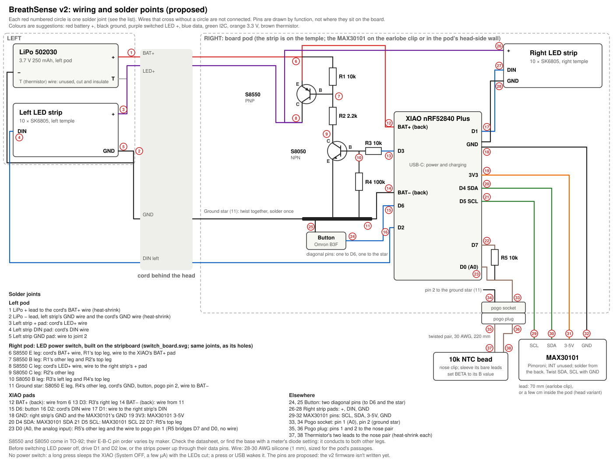
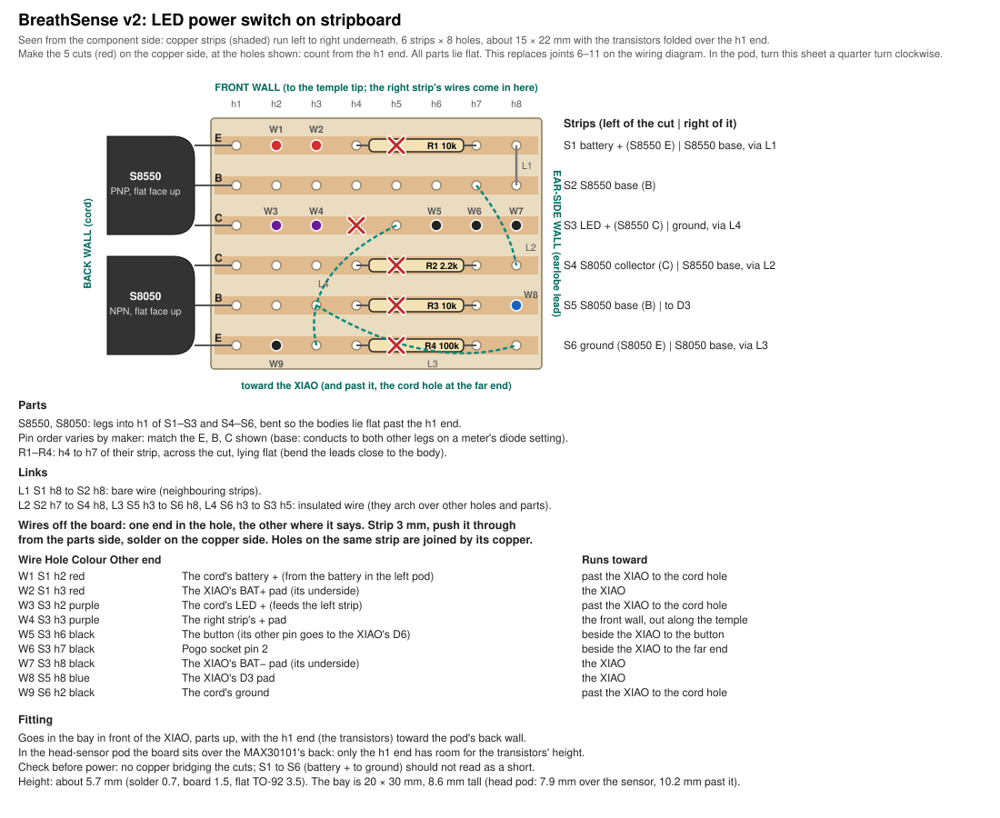
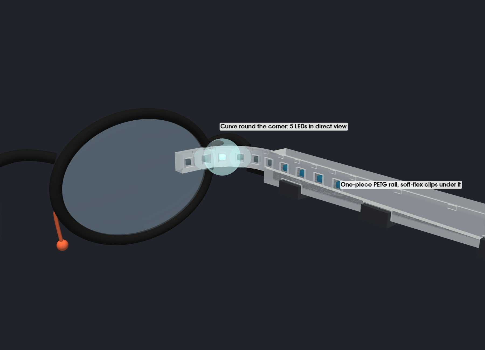
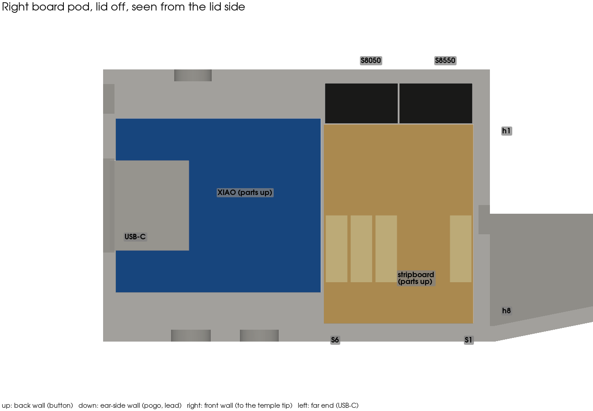
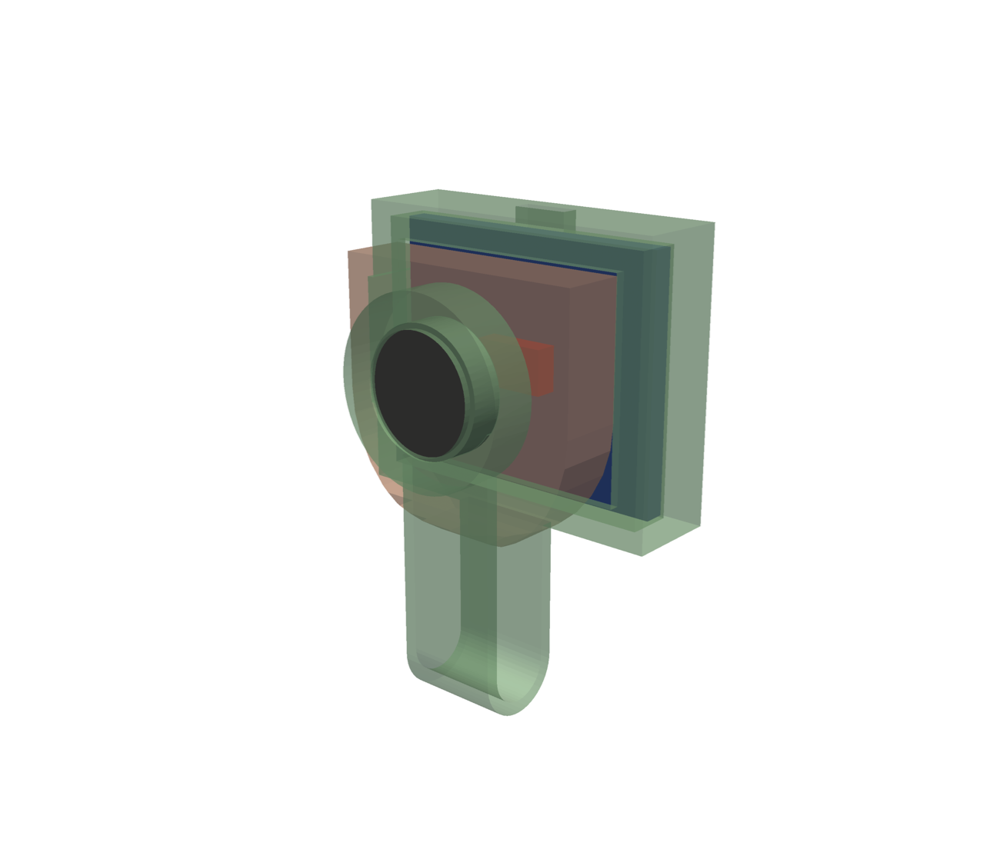

# BreathSense v2 hardware (proposal)

A second hardware configuration for the glasses, worked out from the first
prototype (ItsyBitsy nRF52840, LiPo backpack, neck band). It reuses parts
already on hand: a Seeed XIAO nRF52840 Plus, the 10-LED NeoPixel strips, the
MAX30101 and the 250 mAh cell. New parts cost about $10. Nothing here is built
yet.

## What the wearer sees

The display sits in peripheral vision, which sees motion and brightness
changes well but detail and colour poorly. So every cue is motion. Colour is
only a slow background hint.

Both sides show the same thing. The phone app or the button picks the mode:
heart or breath (guided is dropped; see the specification).

| Signal | Shown as |
|---|---|
| Breath phase | A wave travels forward along the front LEDs on the in-breath and back on the out-breath |
| Breath depth | How far the wave travels and how long the lit segment is |
| Breath length | How fast the wave travels |
| Breath regularity | Steady breathing gives a smooth wave; irregular breathing gives a shimmer of small random brightness changes |
| Heartbeat | A short swell runs from the front back into the temple glow |
| HRV | How much the spacing and strength of the swells vary |

The firmware cross-fades the wave crest between neighbouring LEDs, so behind
the diffuser it reads as smooth motion rather than steps.

The table above was the first proposal. The agreed behaviour is in the
Behaviour specification below: heart bars run from the back toward the eye,
and breath follows the original motion and colours.

## Behaviour specification (agreed 1 Nov 2026)

What the wearable does, standalone and with the app. It adds to the rest of
this README; where they disagree, this section wins (see Discrepancies). The
v1 CircuitPython firmware (`firmware/`, written for the ItsyBitsy nRF52840)
is the reference for the detectors and the heart display. The v2 firmware is
to be a new Arduino C++ port for the XIAO nRF52840 Plus.

**Modes:** heart, breath and off. Guided breathing is dropped.

**Standalone (no app):**
- **Heart, the default:** both sides mirror each other. Each beat is a
  "pa-pum" (lub-dub): a bar of light pulses from the back of the temple
  toward the eye, then a smaller second pulse.
  - **At rest:** once the resting heart rate is learned, it's shown in a
    restful colour (green), with bars that hardly reach the front 4 LEDs
    (the 3 on the corner flap and the one at the hinge).
  - **With stress:** as stress shows in the heartbeat (rate above the
    resting rate, low HRV), the colour turns amber then red and the bars
    reach further, up to all 10 LEDs.
  - This is the v1 `HeartbeatLED` as it stands: 5 LEDs at rest, 10 at full
    stress, green → amber → red.
- **Resting heart rate is remembered:** the learned resting rate and stress
  range are saved to flash. The display is right from the first minute and
  keeps improving over days. (v1 relearns from scratch at every power-on.)
- **Breath:** the original motion. The in-breath lights the front of the bar
  in the breath's colour; the out-breath runs a comet back toward the temple
  over the predicted exhale length.
  - **Stress is exhale length only,** with the original palette and
    thresholds: red under 2 s, white to 3.5 s, light blue to 5 s, purple to
    6.5 s, deep blue beyond.
  - **Calm breaths don't reach the front 4 LEDs.** How far forward the bar
    starts depends on that colour:

    | Last exhale | Colour | Bar starts at (index 9 is the front) |
    |---|---|---|
    | 6.5 s or more | Deep blue | 5 (clear of the front 4) |
    | 5–6.5 s | Purple | 5 |
    | 3.5–5 s | Light blue | 6 |
    | 2–3.5 s | White | 8 |
    | Under 2 s | Red | 9 (all the way to the front) |

    The start positions are a first guess, to tune on the glasses.
- **Button:** a short press switches between heart and breath, and a long
  press puts it to sleep (fully off: System OFF, Bluetooth off). A press or
  USB wakes it, in the last mode it was in (heart or breath), which is saved
  to flash.

**LED numbering:** index 0 is the back of the temple and 9 the front (last
flap LED), as in v1. So fit each 10-LED piece with its data-in (DIN) end at
the temple end, nearest the pod. The front 4 are indices 6–9.

**With the app (Bluetooth):**
- **Connecting changes nothing on the wearable.** It keeps its current mode
  and reports it, and the app shows it.
- **The app can override the mode** at any time: heart, breath or off. App
  "off" darkens the LEDs and pauses sensing, but Bluetooth stays on, so the
  app can turn it back on. Only the button turns the wearable fully off,
  because nothing can wake it over Bluetooth once it's asleep.
- **The app shows** stress level and the rest as before.

**Auto sleep:** after about 2 minutes with no breath and no pulse, but
never while the app is connected (app-off included), and never while on USB
power (it stays awake to charge and show it). So the "charging, plugged in
while asleep" row of the LED table becomes "charging while awake and idle";
that animation isn't written yet.

**Bluetooth name:** `GlassesSense-XXXX`, where XXXX is 4 hex digits from the
chip ID, so two wearables can be told apart. The product may be renamed
GlassesSense; the app's auto-connect list needs "glassessense" added.

**All scoring happens on the wearable; the app only displays it:**
- **Nose clip worn?** Three checks: the pogo plug is in (with it out the
  thermistor input reads full scale), the bead is warm (about 30–34 °C in the
  nostril, against room temperature off the nose; at the entrance it swings
  cooler on each in-breath, so check the threshold on the real clip), and there's a breath
  rhythm in the last few seconds. The heart sensor already knows it's worn
  from its light level.
- **Combined stress:** heart and breath when the nose clip is worn, heart
  alone when it isn't. Weights follow the evidence that HRV is the
  best-supported heart marker of acute stress and that breathing adds
  independent information: **60% heart, 40% breath**, with the heart part
  split 50/50 between heart rate and HRV. They're firmware constants the app
  can override. Neither score is clinically validated, so treat it as a
  personal trend, not a medical measure.
- **The LEDs keep their own rules (above).** The combined score goes to the
  app only.
- **Focus and meditation:** the app's breath scoring (`mood_analyzer.dart`)
  is ported to the firmware unchanged.
- **The app** keeps session history, summaries and reports (bookkeeping
  over the scores it receives), but calculates no scores itself.

**Protocol changes this needs** (see the `breathsense-protocol` skill):
- **The headset reports its mode:** `M,{F|H|O}` (breath, heart, off) on
  connect and on every change, whether from the button, the app or waking.
- **The app no longer sends `M,F` on connect.** It waits for the headset's
  `M` report. `M,O` (already in the firmware) becomes the app's off command,
  meaning LEDs dark and sensing paused.
- **A new scores message, headset to app, about once a second:**
  `K,{stress},{focus},{meditation},{heart_stress},{breath_stress},{nose_worn},{heart_worn},{calibrating}`.
  `stress` is the combined score; the parts are sent so the app can show them.
  Scales: `stress`, `heart_stress` and `breath_stress` 0–100; `focus` and
  `meditation` 0–10, as in the app today; the three flags 0 or 1. The app's
  breath stress (−5 to +5) maps to 0–100 as (score + 5) × 10. The app keeps
  its label wording (CALM, TENSE…) as display only.
  The weights can be set with `S,W,{heart},{breath},{hr},{hrv}`.
- **The app's breath-stress tuning moves too:** its five component weights
  are added to the end of `S,M`, so the app's settings screen keeps working
  but the wearable does the sums.
- **Guided messages go:** `M,G`, `S,G` and `S,CS` are dropped. `R` keeps its
  guided fields in place, unused, so older parsers still line up.

### Discrepancies (current code and docs against this spec)

Status (1 Nov 2026): the v2 firmware (`firmware_v2/`) and the app now implement this spec: rows
1-8 and 11 are done in code; 1 still needs the XIAO build and hardware testing.

| # | Where | Now | Spec | Change needed |
|---|---|---|---|---|
| 1 | Firmware | CircuitPython for the v1 ItsyBitsy (strips on D7/D9, battery on A2, slide switch); no C++ | Arduino C++ on the XIAO nRF52840 Plus | Write the port (pins in Wiring) |
| 2 | Firmware, breath LEDs | Inhale lights index 9, the comet always starts at the front | Start position set by exhale colour (table above) | Firmware |
| 3 | Firmware | Standalone mode is a constant (`STANDALONE_MODE`); no button | Button switches heart/breath; last mode saved | Firmware (v2 button) |
| 4 | Firmware | Resting rate and stress range restart each power-on | Saved to flash | Firmware |
| 5 | Firmware + app | On connect both switch to breath (Open) mode | Wearable keeps its mode and reports it | Both, plus the `M` report |
| 6 | App | No off control: modes are open, guided and heart; `M,O` is never sent (only `L,0` blanks the LEDs) | Heart / breath / off | App |
| 7 | Firmware + app | Guided mode in both | Dropped | Both |
| 8 | Firmware | Off is a hardware slide switch (v1); no sleep | Long press = System OFF; wake by button/USB | Firmware (v2 plan already) |
| 9 | This README, "What the wearer sees" | Heartbeat swell runs front to back; breath depth sets the wave's reach; colour only a background hint | Heart bars run back to front; breath reach and colour follow exhale length | Superseded by this section (kept for reference) |
| 10 | This README, "What the LEDs show for each state" | Mode change shows 1, 2 or 3 pulses (three modes) | Two modes on the button | Done: 1 pulse heart, 2 breath |
| 11 | App | Stress shown from app-side breath scoring (`mood_analyzer`) | Standalone breath stress is exhale length only | None: the app can keep its richer score; the LEDs follow exhale length in both cases |

### Where the light can be seen

These angles are estimated from typical frame geometry. The LED sweep test
(below) measures them on real glasses.

- **Hinge and front flap (about 75–95° from straight ahead):** in direct view.
  Position and direction can be told apart, so the travelling cues go here.
  With 6.8 mm spacing, 5 LEDs per side fall in this zone: 3 on the corner's
  flap, 1 at the hinge and the front LED on the rail.
- **Temple, 15–30 mm behind the hinge (about 95–110°):** at the edge of the
  field. Only bright changes are noticed.
- **Rest of the temple:** out of direct view. Its light reaches the eye only as
  glow off the back of the lens, the frame and the skin. It works as a
  brightness channel (swell, pulse), but not as position.

## Parts

| Part | Notes | Cost |
|---|---|---|
| Seeed XIAO nRF52840 **Plus** (on hand) | Same chip as the ItsyBitsy, but 21×17.5 mm. Built-in LiPo charger (no backpack), extra pads. No IMU or microphone | $0 |
| Adafruit Ultra Skinny NeoPixel 1515 strip, 4 mm, 150 LEDs/m (on hand, as 10-LED pieces) | SK6805-EC15 LEDs. One 10-LED piece per side: 3 on the corner's flap against the frame front, 1 at the hinge, 6 along the temple | $0 |
| MAX30101 earlobe sensor, 502030 250 mAh LiPo (on hand) | | $0 |
| Fast 10k glass-bead NTC thermistor (1 mm or smaller) | Breath sensor, at the right nostril's entrance on the nose clip | ~$2 |
| 2-pin 4 mm magnetic pogo connector (on hand) | Nose clip's plug at the board pod | $0 |
| 2 × 12 × 3 mm neodymium discs, N35 or better (bought: a pack of 50) | Earlobe clip's pinch, one each side. Black ferrite discs are about 1/9 as strong and don't hold | ~$3 |
| S8550 PNP and S8050 NPN (TO-92, from a transistor kit: bought), 10k, 2.2k, 10k and 100k resistors (on hand) | LED power switch: cuts all LED power when the display is off or the battery is low. 2N2907A or BC327 also do for the PNP | ~$3 |
| Omron B3F tactile button, tall plunger (on hand) | Wake, sleep and mode. Base 6 × 6 mm, body 3.2 mm tall (7.0 mm with the plunger, measured), standing on the board pod's floor; its round plunger (about 3.5 mm) comes up through a 4.3 mm hole in the lid (about 4.0 mm as printed). Use two diagonal pins | $0 |
| 10k resistor | Thermistor divider, from D1 to D0 (A0), the neighbouring pad (see Wiring) | ~$0.05 |
| 28–30 AWG silicone wire, 0.5 mm sleeving, small heat-shrink | Cord, earlobe lead, nose pair; sleeving for the bead's bare leads in the nose clip's tunnel; heat-shrink on wire joints only | ~$3 |
| Natural (translucent) PETG (on hand), plus PETG in any colour | The one-piece temple parts: a translucent strip in front of the LEDs, the rest in your colour (see Mount) | $0 |
| PETG, plus the soft flex filament (on hand) | Rigid rails and clips, with soft-flex liners and corners (see Mount) | $0 |
| **Total** | | **about $15, or $30 with natural PETG** |

About $33 of the budget is left. If 5 visible LEDs per side look too coarse,
the best use is a custom flex PCB with about 12–14 tiny LEDs for the front
section only.

Strip sources:
- [Adafruit 4368](https://adafruit.com/product/4368)
- [SK6805-EC15 (LCSC)](https://www.lcsc.com/product-detail/C2890035.html): 1 kHz PWM, 3.7–5.5 V

## Layout

- **Behind the right ear:** a pod with the XIAO Plus, the button and a reset
  pinhole. The MAX30101 earlobe arm reaches from it to the back of the
  earlobe.
- **Behind the left ear:** a pod with the battery.
- **Behind the head:** a thin cord with four wires joins the pods: battery +,
  ground, the switched LED supply and the left strip's data. There is no neck
  band.
- **LEDs:** a 10-LED piece on each side: 6 in the rail's channel, 4 in the
  corner piece (1 at the hinge, 3 on the flap). Nothing touches the lens rim, so it fits any frames. Each strip
  has its own data pin, as in v1.
- **Thermistor:** on a soft clip on the right nostril's wing, at the
  nostril's entrance. Its two wires run loose along the cheek and under the ear to a
  magnetic pogo socket on the board pod (see Nose clip).

## Wiring



| XIAO pin | Use |
|---|---|
| BAT+ / BAT− pads (back) | LiPo, through the cord. The XIAO charges it from USB-C and reads its voltage on-board |
| D7 | Right strip DIN |
| D2 | Left strip DIN, through the cord |
| D3 | LED power switch: high = LEDs on (the S8050 pulls the S8550's base low) |
| D4 SDA, D5 SCL | MAX30101, on the earlobe clip's 4-wire lead |
| D6 | Button to GND (internal pull-up; wakes from System OFF) |
| D1 | Feeds the thermistor divider's 10k, high only while reading. Next to D0, so the 10k bridges the two pads with no wire |
| D0 (A0) | Divider midpoint: 10k from D1, thermistor (via the pogo plug) to GND. A0 is the D0 pad: the XIAO's analog inputs A0–A5 are D0–D5 |
| 3V3, GND | MAX30101 power |

These match the v2 firmware (`firmware_v2/wearable/config.h`); not yet tested on the
hardware. The cord behind the head
carries BAT+, GND, the switched LED supply and the left strip's data.

Build the switch on a small stripboard: 
It replaces joints 6–11 on the wiring diagram.

Check the finished wiring with a multimeter: [WIRING_TESTS.md](WIRING_TESTS.md)
(everything connected, with the LiPo unplugged for the resistance tests; every joint covered).

**LED power switch** (all through-hole, from the DollaTek transistor kit: S8550
PNP, S8050 NPN; a 2N3906 also does for the PNP):

```
BAT+ ──┬─────────── E  S8550 (PNP)
       │                C ─────────── LED+ (both strips)
      10k               B
       │                │
       └────────────────┤
                       2.2k
                        │
                        C  S8050 (NPN)
D3 ──── 10k ──────┬──── B
                 100k   E ─── GND
                  │
                 GND
```

- D3 high: the S8050 pulls the S8550's base low through the 2.2k, and the
  LEDs get power. D3 low: the 10k pulls the base up to BAT+ and they're off.
- The S8050 is needed because a 3.3 V pin can't pull the S8550's base up to
  the battery's 4.2 V to turn it off.
- Check each transistor's pinout (E-B-C order varies by maker): on a meter's
  diode setting, the base conducts to both other pins.
- Before turning the LEDs off, drive D7 and D2 low, or the strips power up
  through their data pins.

## Power and switching

There is no power switch.

- **LED power** comes from the battery through an S8550 PNP transistor, driven
  by an S8050 from D3 (see Wiring). It loses about 0.1 V and draws about
  1.5 mA of base current while lit, about 5% of runtime. It's off
  whenever the LEDs are dark, because each NeoPixel draws about 1 mA even when
  showing black.
- **LED low-voltage cut-off at 3.6 V.** The SK6805 is rated for 3.7–5.5 V.
  Below that, blue dims and the LEDs can misread data. When the battery reads
  under 3.6 V, the firmware:
  1. switches the LEDs off;
  2. sends a low-battery notice to the app;
  3. goes into deep sleep until USB is plugged in.

  This gives up roughly the last 20% of the cell. A 5 V boost converter for
  the LEDs would recover it, if needed later.
- **Auto sleep.** With no breath and no pulse for about 2 minutes (glasses off),
  the board switches off the LEDs and the MAX30101 and goes into nRF52 System
  OFF, drawing a few µA.
- **Wake.** Press the button. Plugging in USB also wakes it. After waking it
  shows a short start-up sweep. If it sees no breath or pulse within 30 s, it
  goes back to sleep, so a knock in a bag doesn't leave it running.
- **Button while awake.** A short press changes mode. A long press puts it to
  sleep.
- **Watchdog timer.** The nRF52 hardware watchdog resets the board if the
  firmware hangs. After the reset it goes back to sleep, so a hang can't drain
  the battery.
- **Reset pinhole** over the XIAO's reset button, for when everything else
  fails.
- **Charging:** plug USB-C into the right pod. The battery charges through
  the cord.

### What the LEDs show for each state

Every power change shows on the LEDs, so the wearer always knows the state.
These use the same motion language as the main display.

| Event | LEDs |
|---|---|
| Wake (button, USB) | One soft white sweep from the front to the back, about 0.8 s |
| Auto sleep coming | Three slow, dim swells over about 5 s. Pressing the button or breathing on the sensor cancels it |
| Going to sleep (auto or long press) | A sweep from the back to the front that fades out, about 1 s; then dark |
| Mode change | The new mode's pattern plays once (1 short pulse heart, 2 breath), then the display starts |
| BLE connected / disconnected | The existing connect animation / one dim blip; the mode doesn't change |
| Low battery warning (about 3.75 V) | One amber blip every 30 s, on top of the display |
| Low battery cut-off (3.6 V) | Three amber flashes, then the sleep sweep in amber |
| Charging, plugged in while asleep | A slow amber swell every few seconds; steady dim green when full. Runs on USB power, so it costs the battery nothing |
| Recovered from a hang (watchdog reset) | One short red blip, then back to sleep |

The low-battery signals use amber and red because blue fails first as the
voltage drops. Red and green still work at 3.6 V.

### Estimates

| Load | Awake | Asleep |
|---|---|---|
| XIAO with BLE | ~5 mA | ~3 µA |
| MAX30101 | ~3 mA | ~1 µA |
| 20 NeoPixels at indoor brightness, including their idle draw, plus ~1.5 mA switch drive | ~30–45 mA | 0 (switch off) |

Runtime is about 3–3.5 h on 250 mAh, down to the 3.6 V cut-off. Standby is
months.

## Mount

### What to print (current)

The STLs in `out/stl/` are already oriented: don't rotate them. Each name ends in its filament: `_petg` or `_flex` (soft flex). `out/print_layout.step` (from `print_layout.py`) has them all
in one file for Fusion, as they sit on the bed, one body per copy to print.

| File (`out/stl/`) | Material | Qty | What it is |
|---|---|---|---|
| `onepiece_right_body_petg` + `onepiece_right_translucent_petg`, and the same for `left` | PETG in your colour + translucent PETG | 1 each side | LED band and rail, in two colours: load each side's pair together (see below). 5 mm brim: they stand on a narrow edge |
| `hang_pod_board_petg` | PETG | 1 | Right pod: XIAO |
| `hang_pod_battery_petg` | PETG | 1 | Left pod: battery |
| `onepiece_liner_right_flex`, `onepiece_liner_left_flex` | Soft flex | 1 each | L-shaped liner in each one-piece part's channel, on the temple's top and outer face |
| `hang_liner_flex` | Soft flex | 2 | Lines each pod's pocket |
| `hang_back_clip_flex` | Soft flex | 2 | Closed band round each pod's pocket and the paddle (fits either side) |
| `hang_lid_board_flex`, `hang_lid_battery_flex` | Soft flex | 1 each | Press-in pod lids |
| `lobe_clip_flex` | Soft flex | 1 | Magnetic earlobe clip (see Earlobe clip) |
| `nose_clip_w25_flex` … `w40_flex` | Soft flex | 1 of your size | Thermistor band for the nostril, one per wing thickness (see Nose clip) |

**Head-side sensor variant** (see Pods): to try the MAX30101 under the end of
the temple tip instead of on the earlobe, print these in place of
`hang_pod_board_petg`, `hang_lid_board_flex`, the right pod's
`hang_liner_flex` and `hang_back_clip_flex`, and `lobe_clip_flex`. They're the third row of
`print_layout.step`.

| File (`out/stl/`) | Material | Qty | What it is |
|---|---|---|---|
| `hang_pod_board_head_petg` | PETG | 1 | Right pod with the sensor's window in its pocket's head-side wall, 1.6 mm thicker |
| `hang_lid_board_head_flex` | Soft flex | 1 | Its lid |
| `hang_liner_head_flex` | Soft flex | 1 | Right pod's liner, cut away behind the sensor |
| `hang_back_clip_head_flex` | Soft flex | 1 | Right pod's band (this pod is thicker) |

**Band-grip variant of the one-piece part** (the earlier design, kept in case
the liner doesn't hold): print these in place of the `onepiece_right_*` and
`onepiece_left_*` body and translucent pairs and the two `onepiece_liner_*_flex`. They're the fourth
row of `print_layout.step`.

| File (`out/stl/`) | Material | Qty | What it is |
|---|---|---|---|
| `onepiece_right_band_body_petg` + `onepiece_right_band_translucent_petg`, and the same for `left` | PETG in your colour + translucent PETG | 1 each side | The one-piece part with a short hook and the band's grooves, in two colours |
| `onepiece_band_flex` | Soft flex | 2 | Temple band (closed loop) behind the last LED, one per side (fits either side) |

- **PETG:** 0.2 mm layers, 3 perimeters, 30–40% infill, no supports.
- **Two-colour one-piece parts:** each side is a pair of STLs in the same
  place on the bed: `_body` (any colour) and `_translucent` (a U round the
  LED slot along the whole run, in one piece). Select both files and import
  them together; when the slicer asks, load them as one object with multiple
  parts (Bambu Studio, Orca and PrusaSlicer all ask). Then set the translucent
  part to the translucent filament and the body to your colour. In
  `print_layout.step` each pair is two bodies in place.
  Where the colours meet the nozzle oozes at each change, leaving blobs and
  strings (the first print had a mess at the strip's rear end). Turn on a
  prime (wipe) tower and ooze prevention, retract on filament change, and set
  the seam to back or aligned; add purge volume if the colours bleed.
- **Soft flex:** 0.2 mm layers, 20–25 mm/s, little or no retraction, 100%
  infill, no supports. A brim helps the small clips stay down.
- **Handedness:** the parts are modelled for the left temple (y outward, in a
  right-handed frame), so the right-side files are mirrored. Files exported
  before 28 Oct had right and left swapped.
- **Liner:** prints open edge down, so its walls stand up and only the 3.6 mm
  bottom bridges.
- **Test fits first:** a pod with a liner and band on the glasses tip;
  the right one-piece part with its liner; the earlobe clip on your ear; the nose clip on your nostril.

### One-piece temple part (current design)

`onepiece.py` replaces the rail, corner, liners, caps and diffuser below with
**one PETG part per side**. The pods still clip onto the tips (see Pods). It's
shaped to one measured pair of glasses, not universal.



- **The strip stays in one piece.** It runs along the temple, then round the
  hinge corner in one rigid 18 mm-radius curve onto the frame front's back
  face. The glasses can't fold while the part is fitted, so the curve doesn't
  have to bend. 4 LEDs sit on the curve and the frame run, and the next one
  is just behind where the curve starts, so 5 are in direct view.
- **Nothing over the lens.** The strip can't bend sideways within its own
  plane, so it stays at one height all the way along. That height is the top
  rim: on the frame front it sits above the lens, and it passes over the
  hinge knuckle.
- **Enclosed slot.** The strip slides into a closed slot from the rail's open
  back end, 60 mm behind the hinge, and on round the curve to the front end;
  it bends through its thickness, which it does easily (you checked that the
  LEDs slide in). The slot is 2.4 × 5.1 mm for the 1.2 × 4.0 mm strip (PCB
  plus LEDs): printed slots come out 0.2–0.4 mm narrow, and the floor is a
  bridge that may sag a little, so a rough print still leaves room. The
  entry at the back end is the plain slot, with full walls (a flare split the
  walls in the slicer). Before fitting the strip, push something about 1 mm thick through (a
  cable tie or shim) to clear any strings from the colour changes. Its 0.6 mm roof is
  part of the coloured body and also covers the translucent piece's top
  edges, so no light leaks out of the top. The wires come out of the back
  end. A dab of silicone at the back end holds the strip if it creeps.
- **Translucent wall, not thinned.** The head-side wall over the LEDs is
  the full 0.8 mm (two lines) of translucent PETG all along the run, so the
  light gets through wherever the LEDs land and spreads, which helps
  neighbouring LEDs blend. A thinner skin would be one flimsy line along most
  of the wall the strip slides against. If it's too dim, turn the brightness
  up in the app. The LEDs are placed for the strip pushed home against the front end: the
  front LED's centre 3.5 mm from the strip's end (measured), then 6.8 mm apart
  along the strip. The strip runs nearer the curve's centre than the outside
  face, so round the curve its LEDs fall further back than the outside spacing
  suggests: the rear one is about 6.6 mm further back than in the first
  prints, which is why their windows missed. The translucent piece starts 4 mm
  behind the rear LED.
- **Nothing springy in the PETG.** All the give is in the soft flex, so the
  PETG part has nothing thin to snap.
- **Printing.** PETG, top edge down on the bed, no supports (the only
  overhangs are short bridges: over the temple's top, and the floor over the
  2.4 mm slot). The liner prints in soft
  flex on its top face, with the outer pad standing up. The band variant's band
  prints lying flat.
- **No separate test piece.** The part is short enough to print whole as the
  first test, about 2 g. Check that the curve sits against the frame front,
  clears the hinge and stays above the lens, that the strip slides in, and
  that the liner holds it on the temple.

**Measurements to check.** These come from photos or are guesses:
- Where the lens starts below the frame front's top, near the corner
  (`LENS_TOP_Z`, guessed at 4.5 mm below the temple's top edge).
- The frame front's top height beside the hinge (`FRAME_TOP_Z`).
- The hinge knuckle's size and height (`KNUCKLE_Z`, `GUSSET_L`).
- The temple's outline. It assumes a straight top edge and a straight taper
  from 8.1 to 4.0 mm tall, and 4.0 to 3.2 mm thick.

`CLEAR` sets the fit against the temple, and `CURVE_R` the corner radius. A
bigger radius carries more LEDs round the corner, but reaches further along
the frame front.

### Pods hanging off the tips (current)

`hang_pods.py` replaces the earlier pods. The temple tip ends in a paddle: 4.0
mm thick, growing from 6.3 mm tall 20 mm back to 8.5 mm at the end (measured).
Each pod fits over the paddle's last 22 mm, and its body carries on past the
end, down onto the bone behind the earlobe. It doesn't rise above the ear.

| File (`out/stl/`) | Material | What it is |
|---|---|---|
| `hang_pod_board` | PETG | Right pod: XIAO (USB-C out of the far end, down and back when worn) on the floor (no rails), a 20 mm bay at the front for the LED switch, nose clip's pogo socket out of the far end, cord out of the back wall, button on a platform up through the lid, earlobe lead out of the ear-side wall |
| `hang_pod_board_head`, `hang_lid_board_head`, `hang_liner_head` | PETG / soft flex | Head-side sensor variant of the right pod (see below) |
| `hang_pod_battery` | PETG | Left pod: 502030 cell; cord out of the far end |
| `hang_liner` | Soft flex | Lines each pod's pocket. Print 2 |
| `hang_back_clip` | Soft flex | Closed band round each pod's pocket and the paddle, in a groove. Print 2 |
| `hang_lid_board`, `hang_lid_battery` | Soft flex | Press-in lids |
| `lobe_clip` | Soft flex | Magnetic earlobe clip for any adult lobe (see below), on a loose 4-wire lead |

- **Pocket:** a rigid PETG pocket shaped to the paddle, lined with soft flex.
  It wraps both faces and the edge nearest the ear.
- **Locked along the tip:** the paddle's 8.5 mm end can't pass back through
  the pocket's narrower neck, and its end stops against the body. So the pod
  can't slide along the tip either way. It may creep a few mm, squeezing the
  liner, before the rigid stop.
- **Fitting:** the pod goes on from the paddle's back edge (the edge away from
  the ear). Gravity pulls the paddle into the pocket. A soft-flex band, a
  closed loop right round the pocket and the paddle, holds it there. The band
  sits in a groove round the pocket (0.7 mm deep on the faces and the
  ear-side edge, 0.3 mm on the walls' top edges), so it stands only 0.5 mm
  proud on the side against your head. It's 8 mm wide, 11–19 mm back from the
  paddle's end, where the edge is nearly straight.
  1. Slide the band onto the temple over its bare tip (it's loose there).
     With the band-variant one-piece part, its band goes on first.
  2. Put the pod on the paddle.
  3. Roll the band back along the paddle onto the pocket and into its
     groove, 3 mm in from the pocket's open end.
  To remove: roll the band forward off the pocket onto the temple, lift the
  pod away.
- **Wires:** the rail's wires (up to 4 of about 1 mm) run along the paddle's
  back edge in a 2.2 mm channel under the band (1.6 mm where the band crosses), into the body through its
  front wall just under the lid, above the switch board (an earlier hole lower
  down was blocked by R1). The cord between the pods leaves through a 5 × 3
  mm hole: the battery pod's far end, and the board pod's back wall (see
  Board pod inside).
- **Assumption to check:** the paddle grows on its lower edge (nearest the ear
  when worn) and its top edge is straight. If it's the other way round, the
  pocket needs flipping.
- **Weight:** the pods sit behind the ear pivot, so they take a little weight
  off your nose rather than lifting the glasses.
- **Printing:** pods in PETG, head-side face down, no supports (the pocket's
  outer wall bridges over the paddle's space). The liner prints open edge
  down, and the bands lying flat. The band's groove on the head-side face
  makes an 8 mm bridge 0.7 mm up.
- **Board pod inside:** 66 × 10.8 × 32.6 mm overall. It's roomier than its
  parts need, so the wires go in without squeezing (prototype; it was
  63 × 8.7 × 29.0). The cavity is 8.6 mm from floor to lid. Nothing is raised inside
  apart from the button's platform: the XIAO lies on the floor (or on the
  battery wires on its back pads; the USB-C hole is tall enough either way),
  so lay the boards and wires out as suits you. In front of it is a 20 × 30 mm bay, 8.6 mm tall, for the LED
  switch on its stripboard (see Wiring and `switch_board.svg`: about 15 × 22
  mm, 1.5 mm board, parts lying flat, 5.7 mm tall), transistor end toward
  the back wall.
- **Beside the XIAO:** a 9 mm strip between the XIAO's edge and the back
  wall holds three things, each leaving on the side facing where it goes.
  From the far end (the bottom when worn):
  - **Nose clip's pogo socket,** out of the far end in the corner by the back
    wall, so the nose wire drops straight down behind the earlobe. Its 4 mm
    face boss goes through a 4.1 mm hole, flush; its 4.9 mm ring sits in a
    0.2 mm counterbore inside, so press it in from inside (a drop of glue if
    loose). It reaches 3.8 mm in.
  - **Cord to the battery pod,** out of the back wall (toward the back of your
    head) through a 5 × 3 mm hole 5–10 mm from the far end's inside. Its
    wires run to the XIAO's battery pads underneath and, over the button's
    body, to the switch board. It leaves below the button, so its droop hangs
    away from it.
  - **Button,** 14–20 mm from the far end's inside, on a printed platform
    (2.1 mm tall; 3.7 mm in the head-sensor pod), its plunger up through a
    4.3 mm hole in the lid, about 0.5 mm below the lid's face. A dab of glue
    holds it on the platform. Press it toward your head: that pushes the pod
    onto the bone behind the ear rather than sideways. The platform is 5 mm
    along the strip and 6 mm across, so turn the button with its legs along
    the strip: they go straight down past the platform's ends, 0.75 mm clear,
    and the wires solder onto them there. It has 1.5 mm either side across
    the strip.
- **Ear side:** 3 mm between the XIAO and the ear-side wall, for the earlobe
  lead only.

  

  Seen from the lid side with the lid off: the XIAO at the far end (USB-C
  out of it), the stripboard in the bay beside it, parts up. Its h1 end (the
  two transistors) faces the back wall, strip S1 is
  nearest the front wall and S6 nearest the XIAO. That's `switch_board.svg`
  turned a quarter turn clockwise. In the head-sensor pod it sits in the same
  place, over the MAX30101's back.

#### Head-side sensor variant (to try)

The MAX30101 sits in the pocket's head-side wall at the end of the temple tip,
where the temple presses on the head (about 4–5 mm from the tip's end), in
place of the earlobe clip.

- **Thin:** the board's back rests straight on the temple tip (the liner is
  cut away there) and its sensor-side parts poke out through a window in the
  pocket's wall. The chip stands **0.8 mm** past the pod's head-side face, so
  the temple sits only 0.8 mm further out than with the plain pod. The board
  itself, 3.15 mm from its back to the chip's face, is the limit.
- **Pressed by the temple:** the temple's own grip pushes the chip onto the
  skin. No springs.
- **Layout:** the chip edge faces the ear bend, the chip's centre 4.5 mm from
  the tip's end (`SENSOR_AT`), at the tip's top edge (`SENSOR_Z`). The board
  runs back past the tip's end under the pod's floor, below the bay. The
  pocket's head-side wall is carried up past its top edge round the board,
  ending well clear of the band.
- **Held by:** rims along the board's sides (1.3 mm, wider than the earlobe
  clip's 0.8), tabs over its top corners and a cover over its pin tab, in the
  PETG wall; a 1.2 mm backing behind it above and below the temple tip, and
  the tip itself when worn.
- **Slot fit (first print, 3 Nov 2026):** the board wouldn't go in, and the
  thin wall tore pulling support out of the slot. The slot now has PETG
  clearances of its own: 0.35 mm each side across the board (`SLOT_SIDE`),
  0.5 mm more thickness behind it (`SLOT_BACK`, so the board's front stays on
  the rims and the chip just as proud) and 0.2 mm past its top edge. All the
  added material is on the side away from the head.
- **Print without support in the slot.** The backing's underside bridges
  about 9 mm from the front wall to the slot's end, anchored on three sides,
  so it prints as a bridge. Block support there (a support blocker over the
  sensor area, or "don't support bridges"): support inside a 2 mm slot can't
  be got out without tearing the wall.
- **Fitting:** with the lid off, drop the board (sensor side down) onto the
  pod's floor at the front of the cavity, then slide it 7.5 mm toward the
  pocket, through the slot in the front wall, until its edge stops. Solder its
  4 wires from the back; they go straight to the XIAO. Then the switch board
  in the bay above it (transistor end toward the back wall, past the sensor's
  edge, where there's room for their height), the XIAO, and the lid.
- **Where it lands:** on the stand-in head, about 4 mm up the tip from its
  end. It's under the temple, which presses there.
- **Size:** 66 mm long like the plain pod, but 12.4 mm thick instead of 10.8
  (all on the outer side), so the switch board fits over the sensor: 7.9 mm
  over it, 10.2 mm past its edge. It has its own band. No earlobe lead hole.
- **Unproven:** whether this spot gives a clean pulse on every beat (the
  LEDs need every one, live). Try it against the earlobe clip.

### Earlobe clip (current)

`lobe_clip.py` makes one soft-flex part sized for adult earlobes 13–27 mm tall
(intertragic notch to the bottom; the mean is about 19–20 mm) and 2.5–8 mm
thick, free or attached. The magnets set where the sensor sits, so the clip's
shape doesn't have to match the lobe.



- **Back pad:** 21.6 × 21.6 × 6.4 mm, behind the lobe, sensor window facing it.
  Sized for the Pimoroni MAX30101 breakout: 19 × 19 mm, narrowing to 15 mm
  over the bottom 5 mm where the pin holes are, every part on the sensor face,
  chip centred at the top edge.
  - **Board:** goes in from the back, past soft lips along its side edges,
    into a pocket 0.1 mm over its size. At the front it's held on all four
    edges: thin rims along the sides, tabs over the two top corners (round the
    mounting holes, clear of the chip) and a cover over the pin tab, with a
    0.5 mm recess behind the pins for solder that wicks through.
  - **Chip proud:** the chip's face stands 0.5 mm proud of the pad's skin face,
    so it presses into the lobe rather than sitting back behind a rim.
  - **Magnet:** one 12 × 3 mm neodymium disc behind the chip. The chip is
    too near the top edge for it to centre on it, so it sits 4.6 mm lower,
    still covering the chip. The pinch presses the chip itself onto the skin.
  - **Flap:** folds over the back on a living hinge and presses in. It holds
    the magnet against the board; it's 2.2 mm thick, leaving 0.6 mm behind
    the magnet.
  - **Wires:** solder them to the pins from the back, run them along behind the
    tab and out of the rear wall beside it (4.4 × 3.9 mm slot; the flap is
    recessed 0.8 mm over the tab to make room). Rear is the side away from the
    hinge, toward the pod.
- **Keeper strap:** flat and floppy, 32 mm from the pad's bottom edge to the
  front puck. It goes round whatever free edge the lobe has: under a free
  lobe, or round the back edge of an attached one. It replaces the pre-curled
  finger, which fixed the chip's height above the lobe's bottom and needed a
  free lobe. The strap only keeps the clip on.
  - **Length:** long enough for the longest, thickest lobe with the chip high
    on it. On smaller lobes the spare hangs as a loop under the lobe: about
    13 mm on an average lobe, 19 mm on the smallest.
- **Front puck:** 15.5 mm across and 4.2 mm thick, to spread the pinch, with
  the other disc snapped in past a lip.
  - **Lid:** a lid on a living hinge at the puck's forward side folds over
    its outer face. A plug on the lid presses into the lip's opening, down
    onto the magnet, so it can't drop out while the clip is off. (When it's
    worn, the pull toward the pad's magnet holds it in anyway.) A dab of glue
    on the plug makes it permanent.
  - **Polarity:** put the discs in so they attract when the strap is folded.
- **Pinch:** the magnets are the lobe's thickness plus 3.25 mm apart (board,
  chip and skins). With N35 discs that gives about 2.9 N on a 2.5 mm lobe,
  1.6 N on a 5 mm one and 0.8 N on an 8 mm one; the clip weighs about 6 g.
  On a thin lobe it's firm: if it aches or the pulse signal weakens, wear it
  lower where the lobe is thicker. (The first 3 × 9.5 × 0.8 mm discs were
  black ferrite: about 0.03-0.14 N, too weak to feel.)
- **Wearing it:** put the chip on the upper, fleshy part of the lobe, at
  least 6 mm below the notch. Fold the strap round and let the puck snap on.
- **Lead:** 4 loose silicone wires (power, ground, SDA, SCL), 70 mm long. The
  farthest a lobe sits from the pod's exit is 42 mm, checked over ±5 mm of
  ear position and every lobe size, plus 25 mm of slack. It leaves through a
  4 mm hole in the ear-side wall; hold it with a dab of hot glue or silicone
  just inside the hole as strain relief (there's no room for a knot).
- **Check:** `CHIP_OFFSET` puts the chip's centre 2.3 mm below the board's
  top edge, from a photo; and the side rims (0.8 mm) must clear the parts
  nearest the side edges.
- **Printing:** flat, skin side down, no supports: pad, strap, puck, open
  flap and open puck lid all start on the bed. The only overhangs are the 1 mm lips and the puck's lip.

### Nose clip (current)

`nose_clip.py` makes a small U-shaped band of soft flex (4 mm wide, 1.2 mm
thick, about 9 mm tall) that goes over the rim of the right nostril's wing
and holds the breath thermistor upright at its entrance. It's held by the
nose, not the glasses, so it stays put when the glasses move.

- **The band:** one leg inside the nostril, one on the skin outside, the bend
  under the rim. It's printed shaped to the wing, with the legs 0.8 mm closer
  together than the wing is thick, so the only grip is that light squeeze,
  spread over both 4 mm legs. Chamfered tops let the wing slide in.
- **Sizes:** measure your wing's thickness, pinched gently, and print the
  nearest of `nose_clip_w25_flex` … `w40_flex` (2.5, 3.0, 3.5 and 4.0 mm
  wings). They're tiny, so printing two neighbouring sizes and keeping the
  better one is easiest.
- **Grip:** about 0.15–0.2 N on the wing it's sized for, rising about 0.1 N
  per extra 0.5 mm (estimate, assuming soft flex at 25 MPa). Too firm:
  print the next size up, or lower `SQUEEZE`.
- **Why not PETG:** the earlier PETG ring sprang open from under a 1 mm gap
  onto the wing and pinched hard. PETG is too stiff for a band this short:
  even 0.3 mm of squeeze would press about 3 N.
- **Thermistor:** a short post joined to the inside of the bend holds the
  bead upright at the nostril's entrance: about 1 mm above the lowest point
  of the wing's rim, and 2.5 mm off its inner face, in the airflow. Higher up
  the nostril (it used to be 7–8 mm up, on a stalk off the top of the inside
  leg), it didn't cool fast enough to register the end of an out-breath.
  Touching skin, it would read skin temperature.
- **Wiring:** sleeve the bead's two leads (they're bare) in 0.5 mm tubing
  and slot them down the tunnel from the top of the post. It runs straight
  down the post, 1 mm across, a snug fit for the two sleeved leads. The bead
  stays on top, in the airflow; pull the leads from below to set its height
  (it's at the entrance with its leads just showing). They come out at the
  post's foot, about 2 mm below the rim, outside the nose. Solder them to a twisted pair of 30 AWG silicone wires there
  (heat-shrink each joint); the pair heads back toward the ear.
- **Printing:** flat on its back face, no supports: the tunnel is a diamond
  with a 45° roof, so it needs no bridge. 100% infill, slow, brim.
- **Wire:** 260 mm, loose: from the board pod's lower end, down behind the
  earlobe, under its clip, along the cheek. The path on the stand-in head is
  212 mm, plus 40 mm slack. It ends in the plug half of
  a 2-pin 4 mm magnetic pogo connector; the socket half presses into the
  board pod's far end, by the back wall (see Board pod inside), and its tails solder to D0 (A0) and ground (the
  firmware's divider: 10k from D1 to D0, thermistor from D0 to ground). Set
  `BETA` in `firmware/config.py` to your bead's B value (3435 now).
- **Tugs:** the pogo connector's magnets probably hold harder than the clip
  grips, so a snag could pull the clip off the nose before the plug lets go.
  Leave a slack loop under the ear; if tugs still reach the nose, add a tie-off
  where the wire passes the earlobe clip.
- **Check:** the bead (`BEAD_D`, 0.8 mm assumed) and the pogo socket
  (`hang_pods.POGO`, measured: 4 mm boss 1 mm tall, 4.9 mm ring, 5 mm long
  with its tails).
- **Printing:** translucent PETG, flat on its back face, no supports; the
  only overhangs are the small lead holes. A brim helps it stay down. Spring
  it open a few times to check it doesn't whiten (the sign of overstraining).

### Earlier v2 mount (superseded)


`mount_v2.py` models the mount; `render_v2.py` draws it on the stand-in head
(`renders/`).

The first print, in soft flex filament, was too flimsy everywhere: the clips
didn't grip, and the neck, the hinge corner and the straight sections all
flopped. The v2 mount moves the structure into PETG and uses the soft flex
only where it helps (grip and the corner).


### Parts

| File (`out/stl/`) | Material | What it is |
|---|---|---|
| `test_clip_S`, `_M`, `_L` | PETG | One clip on a short length of rail. Print these first and try them on your glasses |
| `rail_right_S/M/L`, `rail_left_S/M/L` | PETG | The full rail for each temple, in three sizes |
| `liner` | Soft flex | Grip liner. Print 4 (two per rail) |
| `corner_right`, `corner_left` | Soft flex | Carry the front four LEDs round the hinge and along the frame front |
| `diffuser` | Natural (translucent) PETG | Snap-on cover over each rail's LED channel. Print 2; it fits either side |
| `corner_cap_hinge`, `corner_cap_flap` | Natural (translucent) PETG | Covers over the corner's LEDs. Print 2 of each |
| `pod_board_S/M/L` | PETG | Right pod: XIAO, button, MAX30101 arm root. Sized by the temple tip |
| `pod_battery_S/M/L` | PETG | Left pod: battery and the cord junction |
| `lid_board`, `lid_battery` | Soft flex | Press-in lids on the pods' outer faces |
| `pod_liner` | Soft flex | Grip liner under each pod's tip bar. Print 2 |
| `max_arm` | Soft flex | MAX30101 arm and cradle |

`out/step/` holds the same parts as fitted, in worn coordinates.

For Fusion 360, open these with File → Open. Each part comes in as its own
named body:
- `out/all_parts.step`: every part, laid out side by side in print
  orientation.
- `out/assembly_right_M.step`: the right side in place, in size M. It is
  modelled on a straight temple, so the pod sits in line with the temple
  rather than bent down behind the ear.

### Rail

- **Shape:** a PETG bar on the temple's inner face, from 6 mm behind the hinge
  to just before the ear bend. Its open LED channel is on the head side, with
  snap lips, as in v1. The wires carry on along the same channel to the rail's
  back end, then cross the ear bend loose to the pods.
- **Clips:** two clips, each 32 mm long, push down over the temple from above.
  Each has a top bar, an outer leg and two thin PETG leaves angled toward the
  temple. Pushing down, the leaves' sloped bottom edges ride over the temple's
  top edge and swing aside.
- **Grip:** the leaves press the temple against a soft-flex liner. The liner
  slides into a dovetail groove along the rail's temple face from the back end:
  push the front clip's liner all the way forward first, then fit the rear one.
- **Any temple height:** the leaves span the full 9 mm clip height, so they
  grip temples of any height from about 3 mm up.

### Sizes

PETG is far stiffer than the soft flex, so one rail can't safely grip 2–6 mm
temples. Each size covers about 1.3 mm of temple thickness:

| Size | Temple thickness | Grip per leaf | Peak leaf stress |
|---|---|---|---|
| S | 2.0–3.3 mm | 0.4–2.2 N | 5–25 MPa |
| M | 3.3–4.6 mm | 0.4–2.2 N | 5–25 MPa |
| L | 4.6–6.0 mm | 0.4–2.3 N | 5–27 MPa |

The reference glasses (4.0 mm at the front clip, about 3.5 mm at the rear)
take **M**.

The grip figures are 10–70 times the v1 sleeve's. The stresses stay under about
30 MPa (PETG yields at about 50). These come from simple beam formulas, not a
test. PETG also creeps a little under constant load, so the grip may ease off
over weeks. If it does, step down a size.

If a temple tapers past a size boundary between the clips, use the size that
fits the front clip.

### Corner

The corner is soft flex, but printed already bent at 100°, 10° past the
frame's 90°. The old corner was printed straight and kept trying to
straighten, which is why the flap flopped. This one holds its flap against the
frame front at rest, and bends further when the glasses fold.

It slides down onto a tongue on the rail's front end and grips it by a slight
interference fit. It carries the front four LEDs:
- **Hinge:** the 7th LED, on the corner's straight part just before the
  bend.
- **Flap:** the 8th, 9th and 10th LEDs, 1.5, 8.3 and 15.1 mm along it. Two
  snap lips between them hold the strip in.

The flap is 20 mm long, so on most frames it reaches in behind the outer edge
of the lens.

### Diffuser

A thin PETG plate stands 1.5 mm off the channel mouth, so the LEDs blur into a
line, with hooks over the rail's top and bottom edges. Fit it after the strip
is in: hook the bottom edge on, then press the top hook over. Print it in
natural PETG. If the LEDs still show as dots, a thicker plate or a bigger gap
(`DIFF_T`, `DIFF_GAP`) blurs them more.

**Corner caps.** The corner LEDs are the ones in direct view, the ones that
carry the travelling wave, so they get covers too:
- **Hinge cap:** a short cap on the corner's straight part, over the hinge
  LED.
- **Flap cap:** a long cap along the flap, over its three LEDs.

The bend between them is left open, so the corner can still bend when the
glasses fold. Both caps hook over the corner's top and bottom edges like the
rail diffuser. Both fit either side: turn them over for the left.
On soft flex, the hooks hold less firmly than on the rigid rail; if a cap
won't stay, a dot of flexible glue fixes it.

### Pods


- **On the tip:** each pod clips onto the temple tip behind the ear. It slides
  on from the tip's end and sits flat on the bone behind the ear. Only a thin
  bar runs under the tip, on the ear side.
- **Grip:** two PETG leaves inside press the tip down onto that bar, which
  carries a soft-flex liner like the rail's. The liner slides in from the
  tip-end face. The leaves lie in the pod's own plane, so they add no
  thickness. They lean toward the tip's
  end, so sliding the pod on bends them aside, and pulling it off doesn't
  catch.
- **Sizes:** sized by the tip. The reference tip (3.5 × 4.5 mm) takes **M**.

  | Size | Tip thickness | Tip height |
  |---|---|---|
  | S | 2.5–3.3 mm | 3.0–4.3 mm |
  | M | 3.3–4.2 mm | 4.3–5.6 mm |
  | L | 4.2–5.2 mm | 5.6–7.0 mm |

  The pod leaves are shallower (4 mm) than the rail's, so each presses with
  only about 0.15–0.85 N. That is over 10 times a pod's weight, but the tip
  slopes down toward its open end, there's no end stop, and the cord tugs on
  the pods when you turn your head. Pod grip is the weakest in the build:
  test it first.
- **Will it fit your tip?** The pod's slot is a straight, rigid 36 mm run,
  nearly the tip's whole length. Hold a straightedge along your tips: a tip
  that curves along its length, or ends in a ball, won't slide in. A shorter
  pod would fit a curved tip; tell me if you need one.
- **Board pod (right):**
  - **XIAO:** sits under a soft-flex lid on the outer face, with its USB-C
    pointing out of the pod's far end (up and back when worn). Check where
    your board's reset button is: the lid's 1.2 mm reset pinhole assumes it is
    5 mm to one side of the USB-C.
  - **Button:** a 6×6 mm tactile button in the front column. Its plunger
    comes out beside the USB-C.
  - **Wires:** the rail's wires enter at the front. The cord leaves from the
    far end.
- **MAX30101 earlobe clip** (`max_clip`, soft flex, one part):
  - **Tether:** a slack strap, about 47 mm from where it leaves the pod to
    the sensor. It carries the wires and catches the clip if it comes off;
    the magnets, not the tether, set the position. A flange is trapped
    inside the board pod under the lid.
  - **Cradle:** sits behind the earlobe, with the sensor window facing it.
    The breakout slides in from one end, with its 19 mm side along the
    tether and its pin edge toward the tether. An open strip across the back
    along the pin edge leaves room for the solder joints.
  - **Magnets:** two 9.5 × 0.8 mm discs stacked, pressed into a pocket right
    behind the board. Another stack goes in the finger.
  - **Finger:** printed already curled into a U from the cradle's far end. It
    goes under the lobe and up its front, with its magnets opposite the
    cradle's, so the two pull together through the lobe. The gap is 5 mm
    (soft, so roughly 3–7 mm lobes fit), giving 8 mm between the magnets.
    At that distance two stacked discs pull about 0.35 N, a light ear-clip
    squeeze. A single disc each side (about 0.1 N) would slip.
  - **Polarity:** put the cradle's and the finger's stacks in so they
    attract.
  - **Wires:** 4 thin wires (about 0.9 mm: power, ground, SDA, SCL) press
    into a groove along the tether's head-side face. It's 4 mm wide and
    1.4 mm deep, with a 3.4 mm mouth. It runs from inside the pod to the
    solder strip behind the board's pin edge.
  - **Printing:** on its flat side, with no supports.
- **Battery pod (left):** holds the 502030 cell under its lid. The cord comes
  in at the tip end, and the left strip's wires at the front.

### Printing

- **Rails and test clips:** PETG, top face down on the bed, no supports. The
  leaves and outer legs stand up from the bed. Use at least 2 perimeters (the
  leaves are 0.8 mm thick, two lines with a 0.4 mm nozzle). The only overhangs
  are the 45° lead-in ramps and the 1.4 mm channel and lip ledges.
- **Pods:** PETG, head-side face down, no supports. The leaves stand up from
  the bed, and the cavity opens upward. The outer wall bridges 9–11 mm over
  the tip slot.
- **Diffuser and corner caps:** natural PETG, plate down.
- **Liners, lids and arm:** soft flex, flat face down. The arm's cradle rims
  overhang 1.5 mm.
- **Corner:** soft flex, standing on its bottom end.

### Not done or not checked yet

- **Pod placement.** The render's head and ears are rough stand-ins. Where
  the pod sits behind a real ear, and whether the arm reaches the earlobe,
  needs a test fit.
- **Pod grip** comes from the same beam estimates as the rail, and is the
  weakest in the build. Print one pod with its liner and try it, including a
  tug on the cord.
- **Diffusion.** How well 0.8 mm of natural PETG, 1.5 mm off the LEDs,
  smooths them into a line is untested.
- **Hinge screw.** The rail starts 6 mm behind the hinge, and the corner and
  tongue pass over the hinge area. Both are guesses until the screw head's
  position and size are measured.
- **Folding.** How much the corner, and the strip inside it, put up with
  repeated folding is untested. The strip bends tightest at the corner when
  the glasses are folded.
- **Fusion.** The Fusion 360 script in `../glasses/fusion/` builds the v1
  parts only.

## Firmware

The firmware moves to Arduino C++ on the nRF52 core:
- It carries over the existing breath and pulse detectors.
- It keeps the same BLE UART protocol, so the Flutter app is unchanged.
- The animation runs at 100+ fps with sub-pixel interpolation, so waves glide
  between LEDs.
- It handles the button, auto sleep, the watchdog and the 3.6 V cut-off.

## To check before building

1. **LED sweep test on the current glasses.** Light one LED at a time from the
   flap toward the ear. Note where the dot stops being seen as a dot and where
   it stops being noticed at all.
2. **Flicker.** In a dark room, light one LED dimly and move your eyes quickly
   past it. A smooth streak is fine. A dotted trail means the 1 kHz PWM shows,
   and a thicker diffuser or a brighter, more distant glow is needed.
3. **Low-voltage behaviour.** Run a strip from a bench supply, stepping down
   from 4.2 V to 3.4 V. Note where the colours go wrong, then set the cut-off
   just above it.
4. **Test clips.** Print `test_clip_M` (and S and L if you have other glasses)
   and push it onto the temple. It should take a firm push, then not slide or
   twist.
