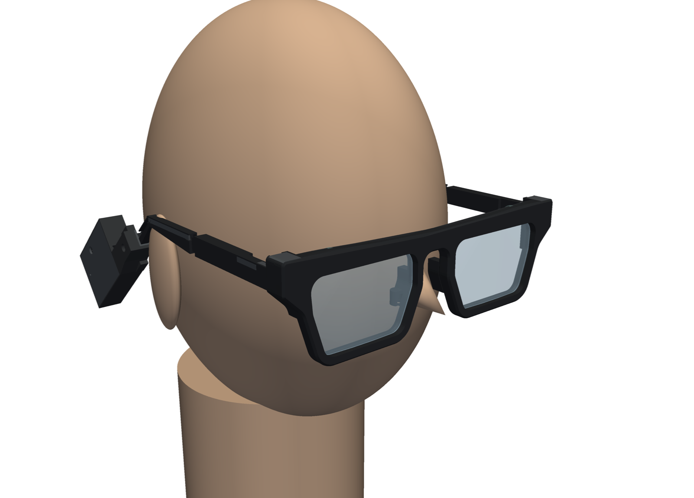
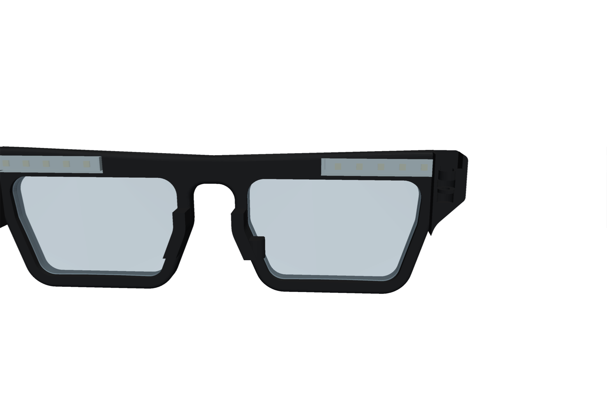
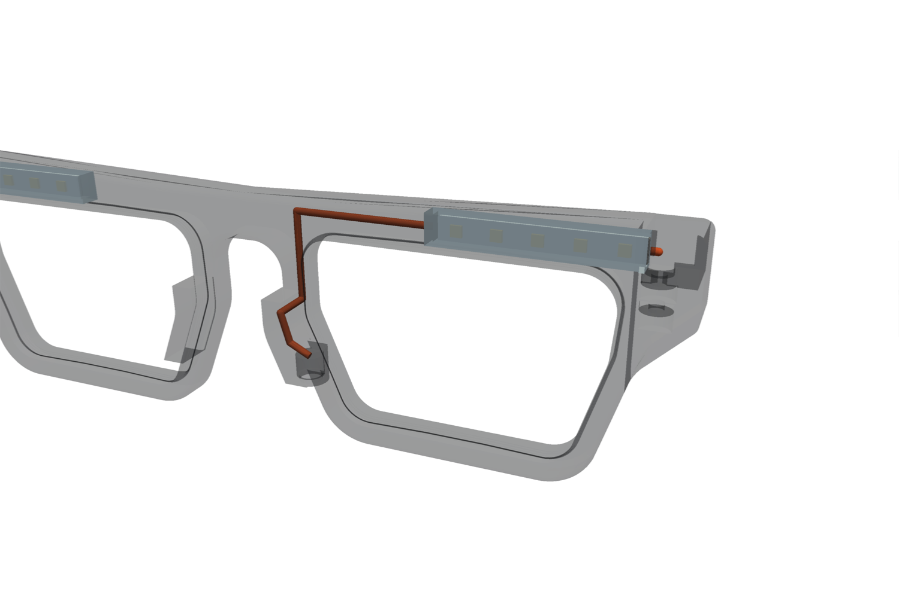
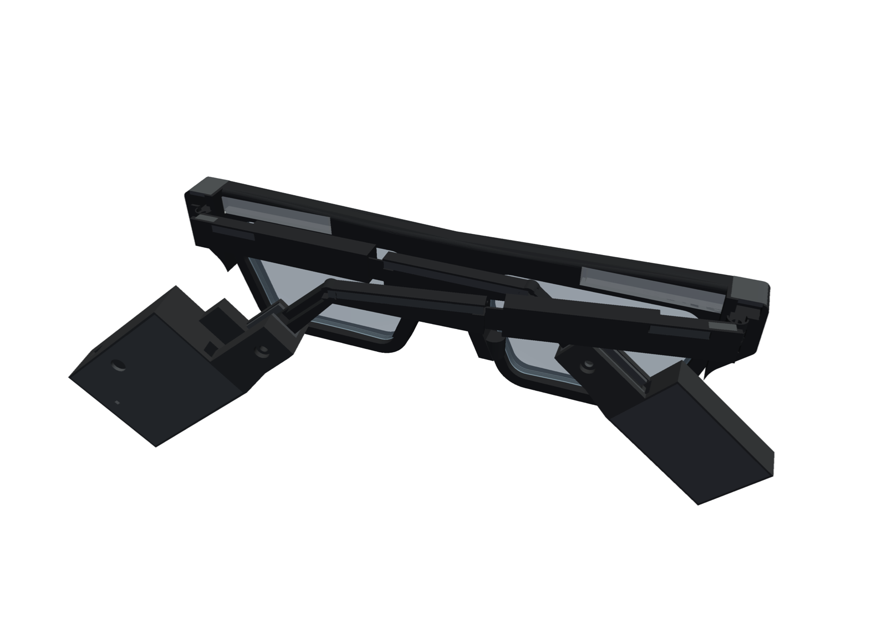

# BreathSense v3: integrated folding glasses (concept)

A custom frame that folds like normal glasses, holds optician-cut lenses and carries the v2 electronics. This is
a concept for checking layout, fit and printability before the detailed design. The `test_front` print checks the
riskiest parts early: the lens popping into the closed rim, the nose pad, the hinge and how visible the LEDs are.






## Decisions (4–5 Nov 2026)

| Topic | Decision |
|---|---|
| Lenses | Stock uncut blanks, edged by an optician to our shape (`out/lens_template.svg` / `.dxf`) |
| Style | Soft wayfarer (`wayfarer.py`; the first concept was too blocky): a brow that lifts toward the outer corners, endpieces sweeping into the rims, a keyhole bridge, rounded edges (45° chamfer on the printed face, fillet at the back) |
| Shape | Wayfarer lens: straight top (the LED strip runs straight under the brow), outer side sloping in, a long bottom-outer corner, the nasal side flaring out below halfway so the nose opening widens downward |
| Lens hold | Closed rim, no split and no screw (5 Nov 2026); the lens pops in from behind with the rim warmed; V-groove like a plastic frame |
| Colours | Black PETG frame; translucent PETG only in front of the LEDs, facing the eye (two-colour print) |
| Fold | Folds like normal glasses: a printed 3-knuckle hinge at each corner on an M2 screw |
| LEDs | 5 per side, all along the front under the brow, over the outer half of each lens (LEDs on the temples can't be seen). Firmware: `LED_STRIP_LEN` 5 (default; 10 for the v2 headset) |
| Electronics | v2 head-sensor board pod (right) and battery pod (left), unchanged inside, on the temple tips' paddle and locked with a screw; v2 cord behind the head |
| Temples | Telescopic (5 Nov 2026), hinge to ear bend 95–107 mm, so the head-side sensor lands in the same place on any head. A tongue on the rear piece slides in a sleeve on the front piece and a soft-flex liner holds it by friction: adjust by hand while wearing them. They rest 2° in when open (more with a shim), so they squeeze the head and keep the sensor on the skin |
| Bridge | Fixed (not telescopic): the lenses' optical centres are set for one bridge width, a split front would be weak at its thinnest point, and head width is handled by the temples' squeeze and nose width by the sloped pads. Another size is another print (`DBL`) |
| Fit | Copied from your glasses: front and lens sizes from your photo beside a ruler (IMG_3650); temple 99 mm to the bend, 39 mm tip at 40° and the paddle profile from the v2 measurements |
| Nose | Pads moulded into the front |
| Thermistor | Magnetic pogo socket in the right nose pad, wired through the front, across the hinge and along the temple to the pod |
| Printing | FDM: PETG (plus translucent PETG for the LED walls) and soft flex; no supports |

## Parts (`out/stl/`; `out/step/` has the same names)

| File | Material | Qty | What it is |
|---|---|---|---|
| `front_body_petg` + `front_translucent_petg` | Black + translucent PETG | 1 | Both closed rims with the lens groove, the bridge, the pads (socket and thermistor tunnel in the right one), both corners with the LED slots, pockets, corner blocks and the hinges' top and bottom knuckles. Two-colour pair, already placed together. Prints front face down. |
| `temple_front_left_petg`, `temple_front_right_petg` | Black PETG | 1 each | Temple front piece: middle knuckle, the squeeze stop (with a shim pocket), front pocket, wire groove, then the 35 mm sleeve (it bulges 1.95 mm toward the head; the outer face stays flat). Prints outer face down. |
| `temple_rear_left_petg`, `temple_rear_right_petg` | Black PETG | 1 each | Temple rear piece: the tongue (wires over its top behind a 45° lip, stop slot on its head side), ear bend and tip, the measured paddle the v2 pods fit. Prints head side down. |
| `liner_joint_flex` | Soft flex | 2 | Liner pressed sideways into each sleeve's head-side recess: grips the tongue (0.25 mm squeeze); its ridge in the tongue's slot gives soft end stops |
| `shim_08_flex`, `shim_09_flex` | Soft flex | 2 each | Optional squeeze shims for the stop's pocket: rest 4.5° or 5.7° in instead of 2°. Print at 0.1 mm layers |
| `pod_board_head_petg`, `pod_battery_petg` | PETG | 1 each | v2 pods with a lock-screw hole added |
| `liner_head_flex`, `liner_battery_flex` | Soft flex | 1 each | v2 liners with the screw hole |
| `lid_board_head_flex`, `lid_battery_flex` | Soft flex | 1 each | v2 lids |
| `cap_pocket_flex` | Soft flex | 2 | Plug over each corner pocket in the front |
| `cap_temple_pocket_flex` | Soft flex | 2 | Plug over each temple's front pocket |
| `cap_groove_front_flex` | Soft flex | 2 | Strip over the front piece's groove, pocket to sleeve |
| `cap_groove_rear_flex` | Soft flex | 2 | Strip over the rear piece's groove, shoulder to bend. Cut a 17 mm piece off it for the tip. |
| `test_front_body_petg` + `test_front_translucent_petg` | Black + translucent PETG | 1 | The right half of the front, with its LED slot, corner pocket, hinge knuckles, pad, socket and tunnel. Print this first. |
| `nose_clip_w*_flex` | Soft flex | 1 | v2 thermistor nose clip, one per wing size (`hardware/v2/nose_clip.py`) |

All of them, as on the bed, in one file for Fusion: `out/print_layout_v3.step` (`print_layout_v3.py`).

Assemblies:
- `out/assembly_v3.step`: worn on the stand-in head.
- `out/assembly_v3_folded.step`: left temple folded, the right one resting on it at 80°.

Fixings needed:
- 2 × M2×10 with nuts (nyloc if you have them) for the hinges;
- 2 × M2×10 with 2 M2 heat-set inserts for the pods.

## Key dimensions

- **Your glasses (photo beside a ruler, ±1 mm):**
  - hinges 148.6 mm apart;
  - lenses 56.2 and 57.2 mm wide where visible, about 36 mm tall;
  - 22–23 mm between the lenses;
  - front about 155 × 43 mm.
- **Lens:** wayfarer shape in an A 58 × B 36 mm box at the bevel apex, corners 6.5 mm. DBL (bridge) 22 mm, so the
  frame PD is 80 mm. Apex perimeter 165.8 mm.
- **Front:** 161 mm wide, 48 mm tall (your glasses: about 43), 6.5 mm deep.
  - Brow top 2.2 mm above the temples' top edge at the bridge, lifting to 4.6 mm at the corners: at least 0.8 mm of
    brow over the LED slot all along it.
  - Bridge 8.7 mm deep: the nose opening's arch is 2.5 mm below the lens tops.
  - Rims 3.6 mm round the sides and bottom; the rim overlaps the lens by 0.5 mm.
  - A corner block behind each endpiece (the open temple stops on it) carries the knuckles and the corner pocket.
- **Lens position:** the lens top is 4 mm below the temples' top edge. Your current glasses have it at about 4.5 mm.
- **Hinge:** axes 148.6 mm apart, as on your glasses, and 4.8 mm behind the front. Each axis sits 2.2 mm in from the
  temple's inner face (on the head side, as normal glasses).
  - 5 mm knuckles, 0.25 mm radial clearance. The front has the top and bottom knuckles, the temple the middle one.
  - When open, the temple's front face stops against the corner, with about 3° of over-open.
- **Temples:** 4.0 mm thick (5.95 at the sleeve, 20–55 mm behind the hinge, bulging toward the head). Inner
  faces 153 mm apart at the hinges.
  - Telescopic: hinge to ear bend 95–107 mm (99 as modelled). The shoulder is the hard stop when shortest; the
    liner's ridge in the tongue's slot gives soft stops at both ends. At full length 22 mm of tongue stays in the
    sleeve.
  - Tongue 2.8 × 4.9 mm plus its lip, 0.15 mm clear in the sleeve; liner 1.2 mm thick, 0.25 mm squeeze.
  - 9 mm tall to the rear piece's shoulder (63.5 mm behind the hinge), tapering to 4.5 mm at the ear bend.
  - The tip is the measured paddle: 8.5 mm tall at its end.
  - Squeeze: they rest 2° in when open (stop face on the front piece against the corner block). Shims in the stop's
    pocket: 0.8 mm → 4.5°, 0.9 mm → 5.7°. Rough stiffness at the sensor (124 mm out): 0.18 N/mm, so on a head
    150 mm wide at the sensor about 0.5 N per side at 2°, 1.5 N at 4.5°, 2 N at 5.7° (beam estimate, ±50%;
    ordinary glasses are about 0.5–1 N).
- **LEDs:** centres 68.2, 61.4, 54.6, 47.8 and 41.0 mm from the middle, at the 6.8 mm pitch.
  - That covers the outer half of each lens; the lens centre is at 40 mm.
  - They sit in a straight 2.4 × 4.6 mm slot under the brow, facing the eye through a 0.8 mm translucent wall,
    their centres 3.7 mm above the lens top. The translucent U (eye-side wall, floor, skin on the far face) runs
    the whole LED run so the light blends into one bar.
- **Nose pads:** 4 mm bands behind the nasal rims, 15.5 mm tall, following the rims' flare: 14.8 mm apart at the top,
  22.3 mm at the bottom. 6.8 mm deep (back from the front).

## Lens spec for the optician

- Edge to the template, `out/lens_template.svg`. It's 1:1 in mm with a 50 mm check bar, and `.dxf` has the same outline.
  The outline is the **bevel apex**: A 58, B 36, DBL 22, apex perimeter 165.8 mm (wayfarer shape, 5 Nov 2026).
- **Bevel:** a standard V-bevel, 110° included, in the middle of the edge, with about 0.8 mm of bevel height.
- **Base curve:** 2 dioptres (front radius about 265 mm). The groove follows that curve inside the flat-faced rim.
  A 4-base lens would sag about 2.5 mm over the lens and run off a 6.5 mm rim. Flatter lenses are fine.
- **Edge thickness:** 2.0 mm or more. Mount the optical centre at your PD and the height you measure (see below).
- **Blank size:** the frame PD is 80 mm. With a typical PD of 62–64 mm, each lens is decentred about 8 mm. That
  needs a blank of roughly 80 mm or more. Your current glasses show it's possible, but ask the optician.

## How it goes together

1. **Strips.** Cut each 10-LED strip between LEDs 5 and 6 on the cut mark, giving one 5-LED piece per side.
   - Solder 3 extra-flexible wires (30 AWG silicone or finer; they flex every time the frame folds) to the DIN end,
     long enough to reach from the corner pocket over the hinge into the temple's front pocket, about 40 mm.
2. **Strip in.** With the corner pocket open, push the strip (LEDs facing back, toward the eye) along the slot
   under the brow, inner end first, until it's home; its DIN end stays in the pocket. Its 3 wires leave the pocket
   through the notch in its back wall, just above the hinge's top knuckle.
3. **Thermistor (right side).** Push the magnetic pogo socket up into the right pad from below, face down.
   - Thread its 2 wires (30 AWG enamelled, twisted) up the tunnel: up the pad, forward into the nasal rim, up the
     rim and along the brow (in front of the LED slot) into the corner pocket. They leave with the LED wires.
   - Pull them in behind a 0.3 mm fishing line threaded first. Splice to flexible stranded wire in the pocket for
     the part that crosses the hinge.
4. **Hinge.** Fit the temple's middle knuckle between the front's two and push an M2×10 through from the top,
   with the nut in the trap underneath. Tighten until the temple holds its position but still folds.
5. **Temple joint.** Press the joint liner sideways into the sleeve's head-side recess (in through the sleeve's
   rear opening). Slide the rear piece's tongue in, lip up and outward; the liner's ridge pops into the tongue's slot.
6. **Wires down the temple.** Use PTFE-insulated 30 AWG (it slides; silicone grips) from the front pocket back.
   - Anchor them in the temple's front pocket with a dab of flexible glue, so length changes never pull on the
     loop over the hinge.
   - Run them back along the front piece's groove, into the sleeve over the tongue, out at the rear piece's shoulder
     into its groove, to the tip, onto the paddle's top edge into the pod's channel and through the LED wire hole.
   - Leave about 15 mm of spare loop in the pod's cavity: pulling the temple out draws it out (12 mm of travel).
     Set the length with the temple fully out before cutting the wires.
   - The thermistor's 2 wires land on A0/GND.
7. **Wire loop.** Leave a little slack in each pocket. Fold and open the temple a few times before closing, to check
   the wires bend at the hinge and don't stretch.
8. **Close.** Press the soft-flex caps into the corner pockets (their tops follow the brow), the temple pockets and
   the grooves.
9. **Pods.** Push each pod onto its tip and lock it with an M2×10 screw through the pocket into the heat-set
   insert. The cord runs between the pods as on v2.
10. **Lenses.** Warm the rim with a hair dryer (60–70 °C: warm to the touch, well below PETG's 80 °C softening).
   Seat the lens's top edge in the groove under the brow first, then press the rest in from behind, working round
   the outer side and the bottom. If the rim stretched evenly, 0.5 mm of overlap would be 1.9% strain; in practice
   it bends locally, which is gentler. Try it on `test_front` first.
11. **Fit.** Put them on and slide each rear piece until the ear bend sits on top of your ear and the sensor on its
    spot behind it. If the sensor lifts off, fit the 0.8 mm shims (more squeeze), then the 0.9 mm ones.

### Wiring (per side)

```
pod (D7 right / D2 left via cord, switched LED+, GND)
  --3 wires: temple outer-face groove, temple pocket, over the hinge, corner pocket--> strip DIN (outer end)
  LEDs 0..4, outer -> inner (4 nearest the nose)
right only: thermistor bead (nose clip) --magnetic plug--> socket in right pad
  --tunnel: pad, nasal rim, brow--> corner pocket --over the hinge--> temple groove --> pod: A0 (divider) and GND
```

Firmware (`firmware_v2`, built with the default `LED_STRIP_LEN` 5): index 0 is the DIN end at the hinge, 4 the inner
end. Calm breaths stay off the one or two LEDs nearest the nose. The v2 headset's 10-LED strips need
`-DLED_STRIP_LEN=10`.

## Printing

- **Front:** front face down, as exported. The knuckles stand up at the back.
  - The translucent pieces are the LED walls: the U round each slot (back wall, floor and front skin), as on the
    one-piece part. Expect toolchange ooze at the colour joins: use a prime tower.
  - Bridges: each LED slot's translucent wall (4.6 mm) and the thermistor tunnel's round roof (1.3 mm). The 45°
    chamfer on the printed face is at the limit; the pocket and wire gate open upward (no bridge).
  - The lens groove's flanks are 35° from vertical, so they print unsupported. In this model the groove is stepped
    in 4 steps; the detailed design should sweep a smooth V.
- **Temple front pieces:** outer face down. Bridges: the groove's floor (2.2 mm), the sleeve's cavity roof (7.4 mm)
  and the liner recess's (3.8 mm). The knuckle stands up on the head side.
- **Temple rear pieces:** head side down. The tongue's lip is at 45°; the stop slot's roof bridges 1.5 mm.
- **Joint fit:** 0.15 mm clearance round the tongue, and the liner takes up the rest. If it's loose, print a liner
  0.2 mm thicker; if it's too tight to slide, sand the tongue.
- **Lens groove fit:** FDM holes and grooves come out about 0.1–0.3 mm small. The groove has 0.2 mm of clearance at
  its root; a closed rim can't take up slack, so check the fit with `test_front` before printing the full front,
  and use 0.2 mm layers or finer.
- **Pods, lids, liners:** as in v2.

## Checks run (concept)

- **One solid per part:** yes. The translucent pieces are separate regions by design: one U per LED run.
- **Overlaps in the open assembly:** none left except designed squeezes:
  - pod and lid, pod and liner, liner and temple tip (the v2 0.2 mm squeeze);
  - the soft-flex caps (0.05 mm press fit).
  - The lens has no overlap with the front, so the V bevel seats in the groove.
- **Folding:**
  - The left temple folds flat (90°), and nothing it carries, pod included, touches the front, lenses or pads.
  - The right temple then folds to 80° and rests on the left one, as normal glasses do (75° at full length, where
    the right sleeve meets the left rear piece). Checked at −4, 0 and +8 mm.
  - Folding both at once is checked at 30° steps only to confirm that one goes first.
- **Overhangs:** only the bridges, the chamfer and the stepped groove ledges listed above.
- **Front internals:** the LED slot sits 1.2 mm above the lens groove; the thermistor tunnel keeps at least
  0.5 mm of wall all the way and stays 0.85 mm from the slot and 1.25 mm from the groove; the pads stay behind the
  rim, out of the lens's view.
- **Telescopic temples:** the pieces never touch over the whole travel (−4 to +8 mm) except the liner's designed
  squeeze; the shoulder hits the sleeve 0.5 mm past the short end. Fold checks run at −4, 0 and +8 mm.
- **v2:** unchanged. v3 imports it and changes nothing in `hardware/v2`.

## Assumptions

- Front, lens and hinge spacing come from your photo (±1 mm). Temple 99 mm to the ear bend, a 39 mm tip at 40°,
  and the paddle profile come from the v2 measurements.
- Temples run straight back from the hinges, 153 mm apart. Real temples usually angle in toward the ears; see
  measurement 3. The stand-in head in the renders is narrower (140 mm), so the temples float off it there.
- Lens: plano or low prescription, 2-base, 2.2 mm edge. Pupils at the lens centre's height, 22 mm below the
  temples' top edge (not measured).
- Internal wires:
  - 30 AWG silicone (about 0.6 mm) for the LEDs, extra-flexible where it crosses the hinge;
  - 30 AWG enamelled for the thermistor, except across the hinge.
  - The groove holds 5 wires 0.6 mm thick under its cap. Your current 1.2 mm wires won't fit three abreast.
- Nose pads: plain PETG, not adjustable, moulded into the front and following the rims' flare (14.8 mm apart at
  the top, 22.3 mm at the bottom). Not checked against your nose: see measurement 5.

## Measurements needed from you

1. **Pupillary distance (PD)**, and your pupil height above the bottom of your current lens, or below the temples'
   top edge at the hinge.
2. **The size printed inside your current temple** (for example `57□20 145`): it confirms the photo readings,
   A about 58, bridge about 22. Also your current lens height (B), about 36 mm from the photo.
3. **Temple spread:** the distance between your current temples' inner faces 100 mm behind the hinges, or at the
   ear bend, with the glasses open on a table. It tells whether the temples should angle in.
4. **Your prescription:** sphere, cylinder, add. Also ask the optician which base curve it needs. The frame takes
   2-base; anything steeper needs a deeper rim.
5. **Nose:** where your current pads sit (distance between them, how far below the lens top) and how wide the
   bridge of your nose is at that height.
6. **Strip:** confirm the cut mark between LEDs 5 and 6 on your strip, and that its pitch is 6.8 mm.
7. **Insert:** the outside diameter of the M2 heat-set inserts you have (the hole is 3.2 mm).

## Open questions and risks

- **Wires across the hinge:**
  - Up to 5 wires (3 on the left) bend every time the frame folds. They cross close to the axis, so they bend
    rather than stretch, but fatigue is the main long-term risk.
  - Mitigations: extra-flexible stranded wire, slack in both pockets, and strain relief (a dab of flexible glue)
    where they enter each pocket.
  - Alternatives: a small flex PCB across the hinge, or spring contacts (LEDs off when folded).
- **Printed hinge:** 5 mm PETG knuckles on an M2 screw. Fine for a prototype, but they'll wear. A stock 3-barrel
  metal hinge, heat-set into the front and temple, is the durable option for later.
- **Getting the lens in:** closed rim, no split (your choice, 5 Nov 2026). The brow is stiff, so the outer side
  and bottom of the rim do the giving, warmed. PETG may crack if it's forced cold. Try it on the test front. The
  fallback is a thinner lip (RIM_LIP) or a rear retaining ring.
- **Base curve:** a strong or high-cylinder prescription may need 4-base or more, and then a deeper (8–9 mm) rim.
- **Threading the thermistor:** the tunnel has four bends (rounded). If threading fails, an open groove on the
  back of the nasal rim and the brow, with a soft-flex cap, is the fallback.
- **The cord:** it stays behind the head, as on v2. The frame could carry the battery and the left strip's wires
  through the front instead, but that adds 4 wires across each hinge. Not chosen.
- **Folded size:** with the pods on, the folded glasses are about 193 × 54 × 65 mm (the second temple rests at 80°, so it and its pod stick out past the front; the pods hang below the
  front). They need a case shaped for that. Shorter or more streamlined pods would shrink it.
- **Telescopic joint:** friction alone holds the length. TPE grips well on the pods, but if it creeps, add detent
  bumps on the tongue or a clamp screw through the sleeve. Sliding wires can snag at the shoulder: the PTFE wire
  and a smooth exit there matter. The sleeve's head-side bulge (1.95 mm) is beside the temple of the head, where
  glasses don't usually touch; check it doesn't press.
- **Comfort:** hard PETG pads may need soft-flex covers. Weight is about 31 g of plastic (40 g if solid) plus the
  electronics and lenses.
- **Front height:** 48 mm against your current 43, mostly the brow over the LEDs and the wayfarer rims. Thinner
  rims (RIM) would bring it down.
- **Front LEDs:** they shine straight at the eye from about 4 mm above the lens. Check the brightness and glare
  with the test front in a dim room.
